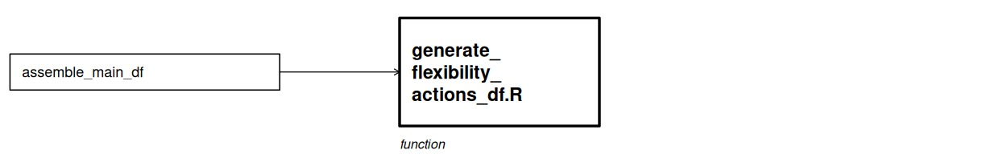

# generate_flexibility_actions_df.R

**Function** &nbsp;·&nbsp; `30_Simulation/03_Functions/generate_flexibility_actions_df.R`

## Function

Builds Flexibility_actions_df on the given time grid. This is a synthetic dataframe (not loaded from a data file): Flex_Act is an engine-level explicit-flexibility tracking signal, stable across building models, so unlike System_df it is not driven by an external variable registry. Initialized to 0 here; set to 1 for rows covered by an accepted flexibility event by 09_flexibility_price_emulation.R.

## Called by

- [assemble_main_df.R](assemble_main_df.md)

## What it calls, in order of appearance

- Nothing: this piece calls no other piece of the project.

## Input data

- time : POSIXct vector. The master 5' time grid of Main_df.

## Output data

- Data frame with two columns, Flex_Act initialized to 0:
    - time
    - Flex_Act

## Other notes from the file header

### Code outline

1. Build one column per flexibility action variable, at its initial value, over the time vector.

### Usage instructions

```r
df <- generate_flexibility_actions_df(registry_path, time)
```

## Diagram



Also available as [generate_flexibility_actions_df.svg](generate_flexibility_actions_df.svg).

---

[Back to the code structure index](../Code_Structure.md)
