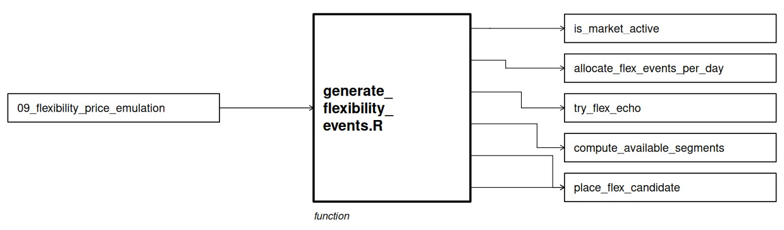

# generate_flexibility_events.R

**Function** &nbsp;·&nbsp; `30_Simulation/03_Functions/generate_flexibility_events.R`

## Function

Market-aware flexibility generation algorithm (Complex_Market_Config == "yes"), in two passes:

1. Scheduling market events, in Bid_time order: for each one, an echo pass (try_flex_echo(), advance/delay of not-yet-displaced prior Scheduling events whose forbidden zone overlaps the new market's horizon) runs before new candidates are placed in the segments still available after the echo pass.
2. Piloting market events, in Bid_time order, after ALL Scheduling events: candidates are placed anywhere in the market's own horizon (no overlap checking of any kind, no echo) and gated by an exponentially decreasing acceptance probability with the horizon h (hours between Bid_time and the candidate's start).

Max_flex_periods_day is a cap per CALENDAR DAY. A market whose horizon is not a day draws its candidates against that cap scaled linearly by the length of its horizon and rounded up, so that the events of a whole day add up to what the parameter declares however many markets cover it. Every event's start/duration (and, for Scheduling's echo, its shift) is discretized to slots of parameters$market$market_resolution

- this is what makes an event's exact placement always

representable as a whole number of Main_df rows. Writes (overwrites) these columns across the whole of Main_df:

- Flex_unit_cost_down_com
- Flex_unit_cost_down_exec
- Flex_unit_cost_up_com
- Flex_unit_cost_up_exec
- Flex_Probab_down
- Flex_Probab_up
- Flex_Act

One accepted event sets its covered rows, everything else is 0 (Flex_Act: 0/1). Piloting is written after Scheduling, so on any overlap Piloting's value prevails (last-write-wins, by design: Piloting is the most up-to-date decision for that moment).

## Called by

- [09_flexibility_price_emulation.R](09_flexibility_price_emulation.md)

## What it calls, in order of appearance

- [is_market_active.R](is_market_active.md)
- [allocate_flex_events_per_day.R](allocate_flex_events_per_day.md)
- [try_flex_echo.R](try_flex_echo.md)
- [compute_available_segments.R](compute_available_segments.md)
- [place_flex_candidate.R](place_flex_candidate.md) &nbsp;(2 call sites)

## Input data

- Main_df    : Data frame. Must already have the Sched_*/Pilot_* market timeline columns (08_market_columns_setup.R) and the Flex_* columns (from Energy_Prices_df).
- parameters : List. Uses:
    - parameters$market:
        - market_resolution
        - Max_flex_periods_day
        - Max_flex_com_price
        - Max_flex_exec_price
        - Max_flex_period_duration
        - Max_flex_probability_down
        - Max_flex_probability_up
    - parameters$flexibility_price_emulation:
        - Max_shift_hours
        - P_advance
        - P_delay
        - P_event_base
        - decay_rate
    - parameters$computing:
        - flexibility_event_margin_sec

## Output data

- Main_df : Data frame, with the seven flexibility columns listed above overwritten as described there.

## Other notes from the file header

### Exceptions and special cases

- A market whose horizon collapses to zero length (clipped at the start/end of the simulated period) is skipped.
- A Scheduling market with no prior events to offer an echo to, or whose Available_m is empty, simply skips straight to (or skips entirely) new-candidate placement - no error.

### Usage instructions

```r
Main_df <- generate_flexibility_events(Main_df, parameters)
```

### Code outline

1. Read the generation parameters and the market resolution.
2. Walk the calendar days of the period.
3. Draw, for each day, how many events it carries and place each one on the segments the day leaves free.
4. Try an echo of every placed event, advanced or delayed.

## Diagram



Also available as [generate_flexibility_events.svg](generate_flexibility_events.svg).

---

[Back to the code structure index](../Code_Structure.md)
