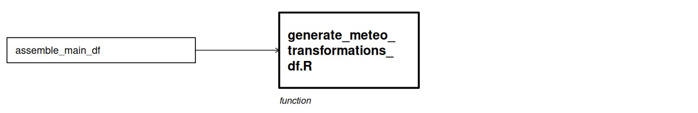

# generate_meteo_transformations_df.R

**Function** &nbsp;·&nbsp; `30_Simulation/03_Functions/generate_meteo_transformations_df.R`

## Function

Builds Meteo_transformations_df on the given time grid. This is a synthetic dataframe (not loaded from a data file): its columns are computed downstream from Meteo_df by existing engine logic:

- T_ext_24h, by 02_load_all_parameters.R
- Text_forec/_ant and SolarR_forec/_ant, by context_forecast_step()/imperfect_forecast()

This function only creates those columns, as placeholders.

## Called by

- [assemble_main_df.R](assemble_main_df.md)

## What it calls, in order of appearance

- Nothing: this piece calls no other piece of the project.

## Input data

- time : POSIXct vector. The master 5' time grid of Main_df.

## Output data

- Data frame with these columns, all but time initialized to 0:
    - time
    - T_ext_24h
    - Text_forec
    - SolarR_forec

## Other notes from the file header

### Code outline

1. Build one column per derived weather variable, over the time vector, from the columns the input series provides.

### Usage instructions

```r
df <- generate_meteo_transformations_df(time)
```

## Diagram



Also available as [generate_meteo_transformations_df.svg](generate_meteo_transformations_df.svg).

---

[Back to the code structure index](../Code_Structure.md)
