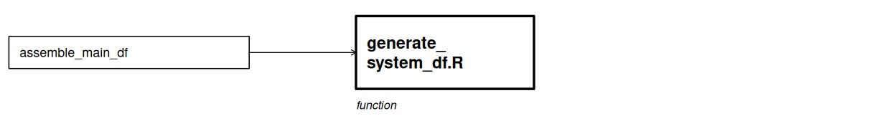

# generate_system_df.R

**Function** &nbsp;·&nbsp; `30_Simulation/03_Functions/generate_system_df.R`

## Function

Builds System_df from the declarative variable registry (Simulation_Variables_Building.txt), on the given time grid. This is a synthetic dataframe: it is not loaded from a data file, it is generated fresh on every run, with every column initialized to its registry initial_value (0 today) - the simulation itself fills these columns in as it runs (period_calculation(), reward_function(), etc.). Variables with scenario == "yes" are expanded into 4 columns (<variable>_exec, <variable>_plan, <variable>_plan_flex_down, <variable>_plan_flex_up); variables with scenario == "no" are kept as a single column, <variable>.

## Called by

- [assemble_main_df.R](assemble_main_df.md)

## What it calls, in order of appearance

- Nothing: this piece calls no other piece of the project.

## Input data

- registry_path : Character. Path to a Simulation_Variables_<name>.txt file, tab-separated, with the columns:
    - variable
    - type
    - initial_value
    - scenario
- time          : POSIXct vector. The master 5' time grid of Main_df.

## Output data

- Data frame, with the columns:
    - time
    - per registry row, in registry order: one column when scenario == "no", four when scenario == "yes"

## Other notes from the file header

### Code outline

1. Read the variable registry and check its columns.
2. Check every scenario flag is yes or no.
3. Build one column per variable, at its initial value, over the time vector.

### Usage instructions

```r
df <- generate_system_df(registry_path, time)
```

### Exceptions and special cases

- If the registry file is missing any required column, stop(). The required columns are those listed under Inputs.
- If scenario contains a value other than "yes"/"no", stop().
- Ti and Te are not special-cased here: their row-1 initial_value is overwritten later by parameters$model$Ti_0/Te_0 in 14_simulation.R (Model initialization block); this function only applies the generic registry initial_value.

## Diagram



Also available as [generate_system_df.svg](generate_system_df.svg).

---

[Back to the code structure index](../Code_Structure.md)
