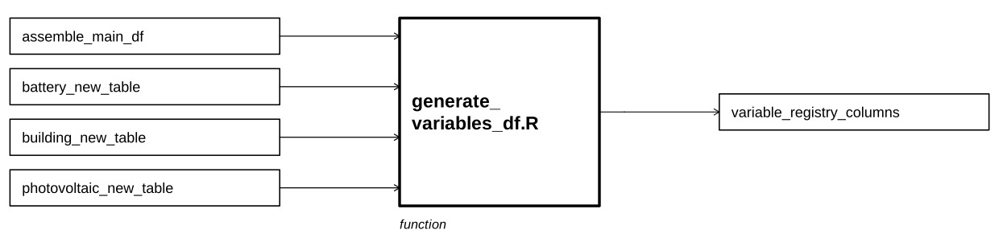

# generate_variables_df.R

**Function** &nbsp;·&nbsp; `30_Simulation/03_Functions/generate_variables_df.R`

## Function

Builds a synthetic dataframe from a declarative variable registry (Simulation_Variables_<name>.txt), on the given time grid:

- from the registry of the system, System_variables_df, which assemble_main_df.R joins into Main_df;
- from the registry of the type of model of an asset (for a building, variables_df), the table of each asset of that type, assets[[asset_id]]$df.

It is not loaded from a data file, it is generated fresh on every run, with every column initialized to its registry initial_value (0 today) - the simulation itself fills these columns in as it runs (period_calculation(), reward_function(), etc.). Each variable is expanded into its columns by variable_registry_columns(): four columns (<variable>_exec, <variable>_plan, <variable>_plan_flex_down, <variable>_plan_flex_up) when scenario == "yes", and a single column, <variable>, when scenario == "no".

## Called by

- [assemble_main_df.R](assemble_main_df.md)
- [battery_new_table.R](battery_new_table.md)
- [building_new_table.R](building_new_table.md)
- [photovoltaic_new_table.R](photovoltaic_new_table.md)

## What it calls, in order of appearance

- [variable_registry_columns.R](variable_registry_columns.md)

## Input data

- registry_path : Character. Path to a Simulation_Variables_<name>.txt file, tab-separated, with the columns:
    - variable
    - type
    - initial_value
    - scenario
- time          : POSIXct vector. The master 5' time grid of Main_df.

## Output data

- Data frame, with the columns:
    - time
    - per registry row, in registry order: one column when scenario == "no", four when scenario == "yes"

## Other notes from the file header

### Code outline

1. Read the columns of the registry (variable_registry_columns())
2. Build one column per entry, at its initial value, over the time vector

### Usage instructions

```r
df <- generate_variables_df(registry_path, time)
```

### Exceptions and special cases

- The registry is checked by variable_registry_columns(), which stops on a missing column or an invalid scenario flag.
- Ti and Te are not special-cased here: their row-1 initial_value is overwritten later by Ti_0/Te_0 of the model of the building in simulate() (Model initialization block); this function only applies the generic registry initial_value.

## Diagram



Also available as [generate_variables_df.svg](generate_variables_df.svg).

---

[Back to the code structure index](../Code_Structure.md)
