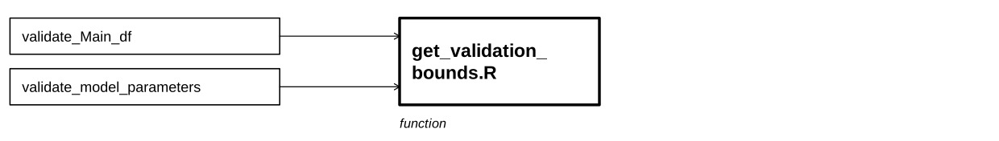

# get_validation_bounds.R

**Function** &nbsp;·&nbsp; `30_Simulation/03_Functions/get_validation_bounds.R`

## Function

Reads the admissible bounds of one magnitude out of a validation configuration table, so that no numeric limit has to be written in the code that applies it.

## Called by

- [validate_Main_df.R](validate_Main_df.md)
- [validate_model_parameters.R](validate_model_parameters.md)

## What it calls, in order of appearance

- Nothing: this piece calls no other piece of the project.

## Input data

- validation_config : Data frame. Content of a validation table of 00_Validation/, one rule per row, with the columns:
    - file_name
    - parameter_name
    - type
    - output
    - options
- file_name         : Character. Value of the file_name column that identifies the parameter file or dataframe the magnitude belongs to (e.g. "Main_df").
- parameter_name    : Character. Name of the parameter or column whose bounds are requested.

## Output data

- Named list with: min    : Numeric. Lower bound, NA if the magnitude is unbounded below. max    : Numeric. Upper bound, NA if the magnitude is unbounded above. output : Character. "Error" or "Warning", the severity the validation file assigns to this magnitude.

## Other notes from the file header

### Why the bounds are read instead of written

A limit written in the code is invisible to whoever configures the simulation, and it is duplicated as soon as a second piece of code needs the same limit. Every limit therefore lives in a validation file under 30_Simulation/02_Config/00_Validation/, and the code that enforces it asks for it here. A limit that is missing from the file is an error, not a silent absence of checking: the caller declares that it validates that magnitude, so the file must say how.

### Code outline

1. Locate the single rule of this magnitude
2. Split the options field into its two bounds

### Usage instructions

```r
bounds <- get_validation_bounds(bounding_validation_config, "Main_df", "Text")
```

### Exceptions and special cases

- An options field with an empty side ("-1," or ",60") means the magnitude is unbounded on that side, and that side is returned as NA. R's strsplit() drops a trailing empty field, so the split result is padded before being read.
- A rule whose two sides are both empty is rejected: it would declare a validation that checks nothing.

## Diagram



Also available as [get_validation_bounds.svg](get_validation_bounds.svg).

---

[Back to the code structure index](../Code_Structure.md)
