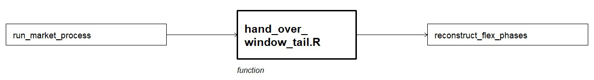

# hand_over_window_tail.R

**Function** &nbsp;·&nbsp; `30_Simulation/03_Functions/hand_over_window_tail.R`

## Function

Packs what the optimization of a market needs to continue a flexibility window whose Commitment Phase started in the simulated stretch before i_begin_horizon and whose tail runs into the horizon: the rows the tail occupies, their phases, the state the window left in its itinerary at i_begin_horizon, and the system that provides it. The itinerary of the tail itself is not handed over. The optimization continues it over the plan of each candidate, from that state.

## Called by

- [run_market_process.R](run_market_process.md)

## What it calls, in order of appearance

- [reconstruct_flex_phases.R](reconstruct_flex_phases.md)

## Input data

- stretch_chunk   : Data frame. The simulated stretch, rows 1 to the end of the tail, after derive_flex_itineraries() has projected the windows over it.
- committed_chunk : Data frame. The same rows before the projection, carrying the committed energy (Elec_flex_down_plan, Elec_flex_up_plan) as it stands.
- i_begin_horizon : Integer. Row of the stretch where the optimization horizon starts.
- tail_end        : Integer. Last row of the stretch occupied by the window, as pre_horizon_window_tails() returns it.
- leg             : Character scalar, "down" or "up".
- parameters      : Named list. Used by reconstruct_flex_phases().

## Output data

- Named list: rows   : Integer vector. Rows of the tail, counted from the first row of the optimization chunk (i_begin_horizon is row 1). phases : Integer vector, one per row: 1 Commitment, 2 Neutral, 3 Recovery. state  : One-row data frame. Ti, Te, Act_heat, Act_cool, Q_heat and Q_cool of the itinerary of the leg at i_begin_horizon. system : Character scalar, "heat", "cool" or "none". The system that provides the window, read over its Commitment Phase with the rule of the window builders.

## Other notes from the file header

### Code outline

1. Rows and phases of the tail
2. State at i_begin_horizon and system of the window

### Usage instructions

```r
tail <- hand_over_window_tail(stretch_chunk, committed_chunk,
  i_begin_horizon, tail_end, "down", parameters)
```

### Exceptions and special cases

- A window the projection could not draw is held with its Commitment Phase alone (hold_standing_window()). Its Neutral and Recovery Phases are then read from the committed energy (reconstruct_flex_phases()), because they still belong to it.
- A window held that way leaves the plan's state in its itinerary.

## Diagram



Also available as [hand_over_window_tail.svg](hand_over_window_tail.svg).

---

[Back to the code structure index](../Code_Structure.md)
