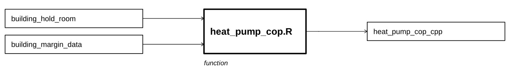

# heat_pump_cop.R

**Function** &nbsp;·&nbsp; `30_Simulation/05_Models/01_Building/03_Functions/heat_pump_cop.R`

## Function

Returns the heating COP of the heat pump at each outdoor temperature. The COP is referred to a rating point: it equals COP_hp_heat_1_coef1 at the reference outdoor temperature and supply temperature, and moves linearly with each of them. It is never below 1: where the line falls below 1, the COP is 1. The COP is not computed in R. It is computed by heat_pump_cop_cpp(), the compiled function the period simulation uses too, so that the simulation and the R code share one electrical model and get the same values. This function only reads the parameters it needs from the parameters of the building and passes them on. It is kept apart from heat_pump_electricity() so that a caller that evaluates the electricity several times over the same rows computes the COP only once.

## Called by

- [building_hold_room.R](building_hold_room.md)
- [building_margin_data.R](building_margin_data.md)

## What it calls, in order of appearance

- [heat_pump_cop_cpp.h](heat_pump_cop_cpp.md)

## Input data

- Text       : Numeric vector. Outdoor temperature, in degC.
- asset      : Named list. The parameters of the building, its entry of parameters$assets. Reads, from asset$model:
    - COP_hp_heat_1_coef1
    - COP_hp_heat_1_coef2
    - COP_hp_heat_1_coef3
    - Text_ref_hp_heat (degC)
    - Tsup_hp_heat (degC)
    - Tsup_ref_hp_heat (degC)

## Output data

- Numeric vector, the length of Text. The heating COP at each outdoor temperature, never below 1.

## Other notes from the file header

### Code outline

1. The COP at each outdoor temperature

### Usage instructions

Needs period_simulation_cpp.cpp compiled with Rcpp::sourceCpp(), which exports heat_pump_cop_cpp().

```r
cop_heat <- heat_pump_cop(Text, asset)
```

## Diagram



Also available as [heat_pump_cop.svg](heat_pump_cop.svg).

---

[Back to the code structure index](../Code_Structure.md)
