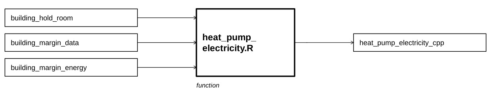

# heat_pump_electricity.R

**Function** &nbsp;·&nbsp; `30_Simulation/05_Models/01_Building/03_Functions/heat_pump_electricity.R`

## Function

Returns the electricity the HVAC systems draw, step by step, for a given heating and cooling energy, so that the flexibility builders can bound an itinerary in electricity without running the simulation:

- the heat pump covers the heating up to its first rated point, Q_hp_heat_1, at the COP of the moment (heat_pump_cop());
- the backup resistances cover the rest of the heating, at COP 1;
- cooling has a single constant COP.

The electricity is not computed in R. It is computed by heat_pump_electricity_cpp(), with the same compiled expression the period simulation evaluates at every step, so that the simulation and the R code share one electrical model and get the same values. This function only reads the parameters it needs from the parameters of the building and passes them on.

## Called by

- [building_hold_room.R](building_hold_room.md)
- [building_margin_data.R](building_margin_data.md)
- [building_margin_energy.R](building_margin_energy.md)

## What it calls, in order of appearance

- [heat_pump_electricity_cpp.h](heat_pump_electricity_cpp.md)

## Input data

- All the vectors are the same length, one entry per time step. Q_heat     : Numeric vector. Heating energy of each step, in kWh. Q_cool     : Numeric vector. Cooling energy of each step, in kWh. cop_heat   : Numeric vector. Heating COP of each step, as heat_pump_cop() returns it. delta_t_h  : Numeric vector. Length of each step, in hours. asset      : Named list. The parameters of the building, its entry of parameters$assets. Reads, from asset$model:
    - Q_hp_heat_1 (kW)
    - COP_hp_cool

## Output data

- Numeric vector, the length of the inputs. The electricity of each step, in kWh.

## Other notes from the file header

### Code outline

1. The electricity of each step

### Usage instructions

Needs period_simulation_cpp.cpp compiled with Rcpp::sourceCpp(), which exports heat_pump_electricity_cpp().

```r
elec <- heat_pump_electricity(Q_heat, Q_cool,
  heat_pump_cop(Text, asset),
  delta_t_h, asset)
```

## Diagram



Also available as [heat_pump_electricity.svg](heat_pump_electricity.svg).

---

[Back to the code structure index](../Code_Structure.md)
