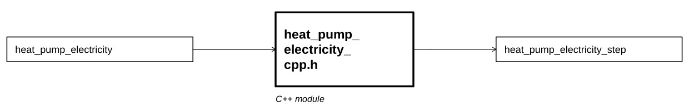

# heat_pump_electricity_cpp.h

**C++ module** &nbsp;·&nbsp; `30_Simulation/05_Models/01_Building/03_1_Functions_Cpp/heat_pump_electricity_cpp.h`

## Function

Returns the total electricity the HVAC systems draw, step by step, for a given heating and cooling energy. Each step is evaluated by heat_pump_electricity_step(), the same expression the period simulation uses, so that R can bound an itinerary in electricity (through heat_pump_electricity()) without running the simulation and without a second copy of the electrical model. The file is a header, included by period_simulation_cpp.cpp, so that the single Rcpp::sourceCpp() call that compiles the simulation also compiles and exports this function.

## Called by

- [heat_pump_electricity.R](heat_pump_electricity.md)

## What it calls, in order of appearance

- [heat_pump_electricity_step.h](heat_pump_electricity_step.md)

## Input data

- All the vectors are the same length, one entry per time step. Q_heat      : NumericVector. Heating energy of each step (kWh). Q_cool      : NumericVector. Cooling energy of each step (kWh). COP_heat    : NumericVector. Heating COP of each step, as heat_pump_cop_cpp() returns it. delta_t_h   : NumericVector. Length of each step (h). Q_hp_heat_1 : Double. First rated heating power of the heat pump (kW). COP_hp_cool : Double. Cooling COP (dimensionless).

## Output data

- NumericVector, the length of the inputs. The electricity of each step (kWh), heating plus cooling.

## Other notes from the file header

### Code outline

1. Check that the vectors have the same length
2. The electricity of each step

### Usage instructions

From R, once period_simulation_cpp.cpp is compiled, through heat_pump_electricity(Q_heat, Q_cool, cop_heat, delta_t_h,

- asset).

## Diagram

Also available as [heat_pump_electricity_cpp.svg](heat_pump_electricity_cpp.svg).

---

[Back to the code structure index](../Code_Structure.md)
