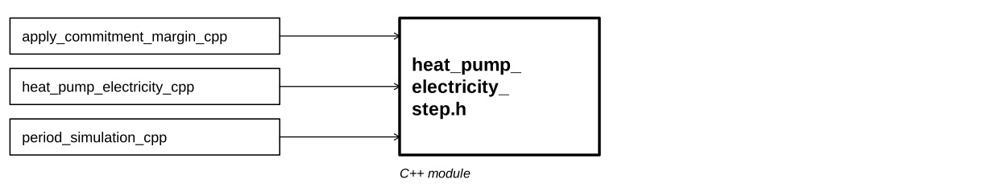

# heat_pump_electricity_step.h

**C++ module** &nbsp;·&nbsp; `30_Simulation/05_Models/01_Building/03_1_Functions_Cpp/heat_pump_electricity_step.h`

## Function

Computes the electricity the HVAC systems draw in one time step for a given heating and cooling energy. It is the only place where this expression is written: the period simulation, the bisection of the commitment margin and, from R, heat_pump_electricity() all evaluate it here.

- The heat pump covers the heating up to its first rated point, Q_hp_heat_1, at the COP of the moment (heat_pump_cop_cpp()).
- The backup resistances cover the rest of the heating, at COP 1.
- Cooling has a single constant COP.

The electricity is a monotone, piecewise linear function of the heat, so a bisection over it needs no simulation. Q_heat is the step's ENERGY (kWh) while Q_hp_heat_1 is a POWER (kW), so the threshold is the energy the heat pump can deliver in the step, Q_hp_heat_1 * delta_t. Comparing the energy against the bare power would make the split depend on the timestep length instead of on the equipment. The minimum and the maximum follow the rule of R's pmin() and pmax() for a missing value: the result is missing when either operand is, and it is the second operand when both are. A missing input gives a missing electricity, as it does in R. The file is a header, included by period_simulation_cpp.cpp, so that it is compiled with the simulation. It is not exported to R.

## Called by

- [apply_commitment_margin_cpp.h](apply_commitment_margin_cpp.md)
- [heat_pump_electricity_cpp.h](heat_pump_electricity_cpp.md)
- [period_simulation_cpp.cpp](period_simulation_cpp.md)

## What it calls, in order of appearance

- Nothing: this piece calls no other piece of the project.

## Input data

- Q_heat      : Double. Heating energy of the step (kWh).
- Q_cool      : Double. Cooling energy of the step (kWh).
- COP_heat    : Double. Heating COP of the step, as heat_pump_cop_cpp() returns it.
- delta_t     : Double. Length of the step (h).
- Q_hp_heat_1 : Double. First rated heating power of the heat pump (kW).
- COP_hp_cool : Double. Cooling COP (dimensionless).
- Elec_heat   : Double, by reference. Receives the heating electricity of the step (kWh).
- Elec_cool   : Double, by reference. Receives the cooling electricity of the step (kWh).

## Output data

- Elec_heat and Elec_cool, written through their references. The total electricity of the step is Elec_heat + Elec_cool.

## Other notes from the file header

### Code outline

1. The heating electricity
2. The cooling electricity

### Usage instructions

double Elec_heat = 0.0; double Elec_cool = 0.0; heat_pump_electricity_step(Q_heat, Q_cool, COP_heat, delta_t,

- Q_hp_heat_1, COP_hp_cool,
- Elec_heat, Elec_cool);

## Diagram

Also available as [heat_pump_electricity_step.svg](heat_pump_electricity_step.svg).

---

[Back to the code structure index](../Code_Structure.md)
