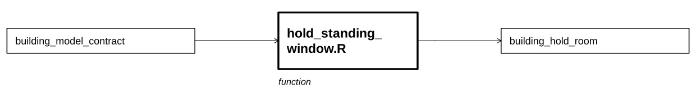

# hold_standing_window.R

**Function** &nbsp;·&nbsp; `30_Simulation/05_Models/01_Building/03_Functions/hold_standing_window.R`

## Function

Keeps a standing flexibility commitment that the builder would not rebuild, by writing it straight onto the electricity itinerary of the leg and marking its Commitment Phase, within the limits of the equipment.

## Called by

- [building_model_contract.R](building_model_contract.md)

## What it calls, in order of appearance

- [building_hold_room.R](building_hold_room.md)

## Input data

- period_chunk : Data frame. The chunk being derived. Reads the column Elec_total_plan, and what building_hold_room() reads.
- leg          : Character scalar, "down" or "up".
- window_rows  : Integer vector. Rows of the standing Commitment Phase. Row 1 is the initial state of the chunk and is never one of them.
- standing     : Numeric vector as long as period_chunk has rows. The committed energy of the leg the building holds, in kWh: what the previous market left, or the part of it the system hands the building.
- parameters   : Named list. Reads what building_hold_room() reads: the bound of an upward window and the horizons and threshold of the choice of its system.
- asset        : Named list. The parameters of the building, its entry of parameters$assets. Handed to building_hold_room(), which reads the model of its heat pump.

## Output data

- The chunk with Elec_total_plan_flex_<leg> carrying the standing commitment over window_rows, as far as the equipment allows, and Flex_phase_<leg>_plan set to 1 there.

## Other notes from the file header

### Why it exists

A refusal of the builder says that it would not draw the window over this plan, not that the commitment is gone. If a window the builder refused were simply dropped, the market would buy the whole commitment back and re-issue nothing, even the part the equipment can still deliver.

### The limits of the equipment

Each row of the held itinerary stays between what the systems can draw (building_hold_room()):

- Downward: the itinerary cannot spend less than nothing, so the commitment of a row is at most the electricity of the plan.
- Upward: the itinerary cannot spend more than the system that provides the window draws at the heat power that bounds an upward window, the higher of the two systems when the prudence rule names none.

The part of the commitment that does not fit is not held. The commitment the itinerary carries is then smaller than the one sold, and the economic chain books the difference as a re-purchase in the guard zone, as it does for a window the new plan cannot hold whole.

### What it does and does not do

reward_function() recomputes the committed energy as the difference between the plan and the leg's itinerary over the Commitment Phase, so writing that difference is what keeps the commitment. The THERMAL columns of the itinerary are left as the plan's, and the next market tries to rebuild the window in full. It is the operation window_hold of the type of model Building (model_type_contract()): the system hands each building that holds a window the part it holds (system_hold_window()), and the caller reports the building and the leg as not technically feasible when the window has rows in the guard zone.

### Code outline

1. The rows worth holding
2. The most each row can hold
3. Impose the commitment on the electricity itinerary

### Usage instructions

```r
period_chunk <- hold_standing_window(period_chunk, "down", rows,
  standing, parameters, asset)
```

## Diagram



Also available as [hold_standing_window.svg](hold_standing_window.svg).

---

[Back to the code structure index](../Code_Structure.md)
