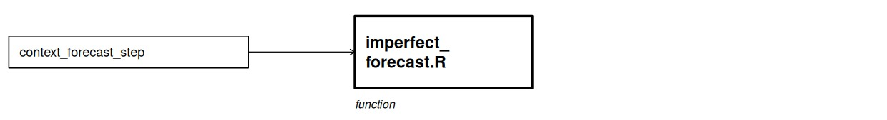

# imperfect_forecast.R

**Function** &nbsp;·&nbsp; `30_Simulation/03_Functions/imperfect_forecast.R`

## Function

Builds a deliberately inaccurate forecast of a weather column over a horizon, as a blend of two things:

- A. The actual future value (ground truth).
- B. A historical average: the same time of day on each of the previous n_days_back days.

The weight of the history grows with how far ahead the instant is, so the forecast degrades the further it looks. The aim is NOT to forecast well. It is to forecast with a controlled amount of error.
Why the error is normalised per day and not per horizon A law normalised by the length of the horizon makes the error of an instant depend on which market is looking at it: with the production configuration the same instant twelve hours ahead would carry one third of the weight seen from a 36 h Scheduling horizon and the full weight seen from a 12 h Piloting one. The error of a forecast is a property of how far ahead it looks, not of who is looking, so the weight is counted per day of horizon and every market that values the same instant values it with the same error.

## Called by

- [context_forecast_step.R](context_forecast_step.md)

## What it calls, in order of appearance

- Nothing: this piece calls no other piece of the project.

## Input data

- Main_df                 : Data frame with the full time series data. Must contain the columns referenced by target_col and time_col.
- target_col              : Character. Name of the column in Main_df to forecast (e.g. "Text" or "SolarR").
- i0                      : Integer. Start index of the forecast horizon in Main_df.
- i_end_horizon           : Integer. End index of the forecast horizon in Main_df.
- n_days_back             : Integer. Number of previous days used to compute the historical average for each forecast step.
- weather_forecast_weight_history : Numeric (0-1). Weight the history carries one day ahead of the start of the horizon. At i0 the weight is 0 and the forecast is the actual value; it grows linearly at this rate and is capped at 1.
- time_col                : Character. Name of the time column in Main_df. Default: "time".

## Output data

- A tibble with two columns: time              : POSIXct. Time index of the forecasted values, matching Main_df[[time_col]][i0:i_end_horizon]. pred_<target_col> : Numeric. Forecasted values of the target column. Column name is constructed as paste0("pred_", target_col).

## Other notes from the file header

### The law of the weight

```r
w(t) = min(1, weight_history * hours_ahead(t) / 24)
```

```r
forecast(t) = (1 - w) * actual(t) + w * history(t)
```

where hours_ahead is counted from the first instant of the horizon. The weight is therefore a rate: weight_history is the weight the history carries one day ahead, two times that two days ahead, and so on, capped at 1, where the forecast is the historical average alone.

### Code outline

1. Horizon, actual values and hours ahead
2. Historical average of each instant
3. Blend

### Usage instructions

```r
forecast_df <- imperfect_forecast(Main_df, target_col = "Text",
  i0 = i0, i_end_horizon = i_end_horizon, n_days_back = n_days_back,
  weather_forecast_weight_history = 0.3, time_col = "time")
```

### Exceptions and special cases

- An instant with no history at all keeps its actual value, and the console says how many instants that happened to. It means the series does not reach n_days_back days behind the horizon, which with the stabilization sized by that same parameter should not happen; and it makes the forecast of those instants exact, so it must not pass unnoticed.
- An actual value that is NA takes the historical average, whatever the weight.
- The history of one instant averages only the days that were found: a missing day lowers the count, it does not void the average.

## Diagram



Also available as [imperfect_forecast.svg](imperfect_forecast.svg).

---

[Back to the code structure index](../Code_Structure.md)
