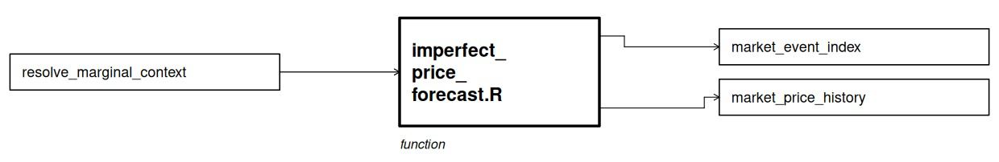

# imperfect_price_forecast.R

**Function** &nbsp;·&nbsp; `30_Simulation/03_Functions/imperfect_price_forecast.R`

## Function

Builds an imperfect forecast of a price signal for the stretch of the optimization horizon that lies beyond the control horizon.

## Called by

- [resolve_marginal_context.R](resolve_marginal_context.md)

## What it calls, in order of appearance

- [market_event_index.R](market_event_index.md)
- [market_price_history.R](market_price_history.md)

## Input data

- target_times : POSIXct vector. The instants to forecast, in order. Those at or before end_control_time are returned untouched.
- true_values  : Numeric vector, same length. The price each instant actually has in the data structures.
- end_control_time : POSIXct scalar. Close of the control horizon. The forecast starts after it.
- The following are passed straight through to market_price_history(); see that function's header:
    - market_name
    - role
    - signal_df
    - Main_df
    - market_time
- n_days_back  : Integer scalar. Days of history.
- weight_history : Numeric in [0, 1]. Weight of the historical average at the far end of the forecast stretch. At its start the weight is 0, that is, the true value.

## Output data

- Numeric vector, same length as target_times. The price the optimizer is allowed to see for each instant.

## Other notes from the file header

### Why it exists

A market publishes prices for the period it trades, which is the control horizon. The optimizer, however, decides over the whole optimization horizon, and it has to value the energy of that longer stretch too. Reading the true price of those later hours straight from the data structures would give the optimizer information it cannot have when it decides: perfect foresight. This function replaces that reading with a forecast which is deliberately inaccurate, so that the error has to be corrected later, in subsequent markets. The aim is NOT to forecast well. It is to forecast with a controlled amount of error.

### Same formulation as the weather forecast

The blend is the one imperfect_forecast() uses for Text and SolarR: a weighted sum of the true future value and a historical average of the same time of day on previous days, with the weight of the history growing at weight_history per day of forecast horizon, so that the forecast degrades the further ahead it looks:

```r
w(t) = min(1, weight_history * hours_ahead(t) / 24)
```

The error of a forecast is a property of how far ahead it looks and not of the length of the stretch it belongs to, which is why the weight is counted per day and not per stretch. Two things differ, and both come from prices not being a flat column of Main_df:

- The history is collected by market_price_history(), which follows the market structure and its fallback rule, instead of averaging the same column on previous days.
- The stretch to forecast starts at the END of the control horizon, not at the start of the horizon. Inside the control horizon the price is published and is used as it is, which is the weight-1 end of the same law.

### Code outline

1. Split the instants into published and forecast
2. Blend, instant by instant, along the forecast stretch

### Usage instructions

```r
p <- imperfect_price_forecast(target_times, true_values, end_control_time,
  market_name, role, signal_df, Main_df, market_time,
  n_days_back, weight_history)
```

### Exceptions and special cases

- An instant with no history at all keeps its true value. It happens at the beginning of the series, when there are no previous days to look at, and it is the same fallback imperfect_forecast() takes.
- The first instant beyond the control horizon carries weight 0 and is therefore exact: hours_ahead is counted from the close of the control horizon, which is where the published price stops and the forecast starts.
- Nothing at or before end_control_time is ever touched: inside the control horizon the market has published a price and the optimizer is entitled to it.

## Diagram



Also available as [imperfect_price_forecast.svg](imperfect_price_forecast.svg).

---

[Back to the code structure index](../Code_Structure.md)
