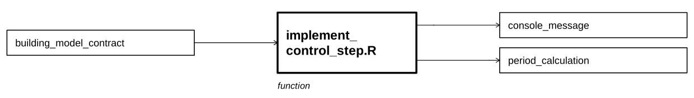

# implement_control_step.R

**Function** &nbsp;·&nbsp; `30_Simulation/05_Models/01_Building/03_Functions/implement_control_step.R`

## Function

This function implements a single MPC control step by running the physical simulation of the building over the window it receives, with the setpoints that the markets have already written in it. The weather it uses is the one period_calculation() reads for the calculation context: the actual (measured) weather for "execution", and the forecast for "plan" and the flexibility contexts. It does not cut the window: period_chunk is simulated as received, and the caller chooses its rows. It is the asset side of the execution: it works with the physics of the building, writes no money and no column of the system. The executed net electricity of the system without a flexibility event (Elec_total_no_flex) is fixed by simulate(), and the execution cash flows of the new rows (Elec_deviations_net_cost_h, Elec_cost_distr_h and Elec_net_cost_h) are settled by settle_execution(), on the net electricity of the system that Main_df holds once every asset has executed the step.

## Called by

- [building_model_contract.R](building_model_contract.md)

## What it calls, in order of appearance

- [console_message.R](console_message.md)
- [period_calculation.R](period_calculation.md)

## Input data

- period_chunk               : Data frame. Full simulation data for at least the current control window. Must contain all columns required by period_calculation(), plus a 'time' column of POSIXct values.
- simulation_control         : Named list. Control metadata. Only simulation_control$calculation_mode is read here (default: 1 = Setpoint mode, used when NULL/absent).
- timestamps                 : Named list. Timestamp metadata, forwarded unused to this function's signature but kept for interface symmetry with run_market_process().
- parameters                 : Named list. Must contain: parameters$debug_and_config$verbose : Logical. Enables console logging.
- asset                      : Named list. The parameters of the building, its entry of parameters$assets, passed to period_calculation().
- calculation_context        : Character. Passed to period_calculation(). One of "execution", "plan", "plan_flex_down" or "plan_flex_up".

## Output data

- period_chunk : Data frame. The simulated control window, with all columns from period_calculation() updated according to calculation_context.

## Other notes from the file header

### Code outline

0. Extract calculation_mode from simulation_control (default 1)
1. Validate: if period_chunk has fewer than 2 rows, return it unchanged (see EXCEPTIONS below)
2. Run period_calculation() with calculation_mode/calculation_context
3. Return updated period_chunk

### Usage instructions

```r
result <- implement_control_step(period_chunk, simulation_control, timestamps,
  parameters, asset, calculation_context)
```

### Exceptions and special cases

- If period_chunk has fewer than 2 rows, the function returns early without calling period_calculation(). A warning message is printed if verbose = TRUE. This is a defensive fallback: the execution-phase call from simulate() already skips calling this function entirely at the last simulation row (where this condition would otherwise always occur), but the guard remains here in case of degenerate horizons from other callers.
- calculation_mode defaults to 1 (Setpoint) when simulation_control$calculation_mode is NULL or absent.

## Diagram



Also available as [implement_control_step.svg](implement_control_step.svg).

---

[Back to the code structure index](../Code_Structure.md)
