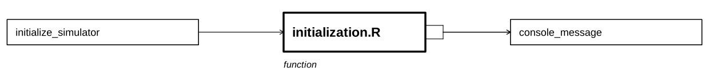

# initialization.R

**Function** &nbsp;·&nbsp; `30_Simulation/03_Functions/initialization.R`

## Function

This function performs the initialization steps required before running the MPC simulation. It carries out two tasks:

1. Sources all R function files found in the specified function directories into the environment given by envir, making them available there.
2. Loads all required R packages listed in a plain-text library file (one package name per line, comment lines starting with '#' are ignored). The startup messages of the packages are suppressed.

The functions are sourced first, so that a package that has to be installed is reported with console_message().

## Called by

- [initialize_simulator.R](initialize_simulator.md)

## What it calls, in order of appearance

- [console_message.R](console_message.md) &nbsp;(2 call sites)

## Input data

- library_file    : Character. Path to a plain-text file listing the names of required R packages, one per line. Lines beginning with '#' and empty lines are ignored.
- function_paths  : Character vector. Paths of the directories that hold the R function files (.R) to be sourced: the functions of the system and those of every type of model.
- envir           : Environment. The environment the function files are sourced into: their functions are defined there, and call each other there.
- lib_path        : Character or NULL. Optional path to a custom R library location passed to library() as 'lib.loc'. If NULL (default), the default library paths are used.

## Output data

- None (called for side effects). Writes one LOAD line to the console on completion, with the packages and the number of function files loaded. When a package has to be installed, a LOAD line says so first.

## Other notes from the file header

### Code outline

1. Source all function files from the function directories
2. Load required libraries from file
3. Report

### Usage instructions

```r
initialization(library_file, function_paths, envir = sim)
```

```r
initialization(library_file, function_paths, envir = sim,
  lib_path = "/path/to/libs")
```

### Exceptions and special cases

- If a package listed in library_file is not installed, it is installed from CRAN before it is loaded.
- If lib_path is NULL, packages are loaded from the default R library paths.
- All .R files in function_paths are sourced unconditionally, folder by folder in the order given and, inside each folder, in the order returned by list.files(); file ordering may matter if functions depend on each other.

## Diagram



Also available as [initialization.svg](initialization.svg).

---

[Back to the code structure index](../Code_Structure.md)
