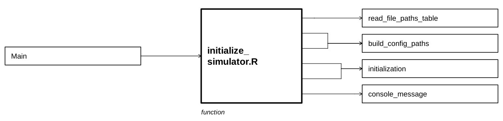

# initialize_simulator.R

**Function** &nbsp;·&nbsp; `30_Simulation/03_Functions/initialize_simulator.R`

## Function

Loads the simulator into an environment of its own, sim, and returns it. sim holds:

- every function of 30_Simulation/03_Functions/ and of the 03_Functions/ folder of every type of model of 30_Simulation/05_Models/
- the compiled C++ modules of the types of model
- paths, the list of every file the simulation reads or writes

Nothing is created in, or removed from, the global environment, so the simulator can be loaded into an R session that already holds other objects, and loaded again, without losing them.

## Called by

- [Main.R](Main.md)

## What it calls, in order of appearance

- [read_file_paths_table.R](read_file_paths_table.md)
- [build_config_paths.R](build_config_paths.md) &nbsp;(2 call sites)
- [initialization.R](initialization.md) &nbsp;(2 call sites)
- [console_message.R](console_message.md)

## Input data

- simulation_path : Character. Path of the 30_Simulation/ folder to load, with the folders:
    - 01_Data
    - 02_Config
    - 03_Functions
    - 05_Models, with one folder per type of model (for example 01_Building), each with its 03_Functions and 03_1_Functions_Cpp

## Output data

- Environment (sim), whose parent is the global environment. It holds:
    - every function of 03_Functions/ and of the 03_Functions/ folder of every type of model
    - period_simulation_cpp(), heat_pump_cop_cpp(), heat_pump_electricity_cpp() and apply_commitment_margin_cpp(): exposed by Rcpp::sourceCpp() from period_simulation_cpp.cpp, in 05_Models/01_Building/03_1_Functions_Cpp/, and the headers it includes
    - battery_trajectory_cpp(), battery_free_trajectory_cpp(), battery_recovery_correction_cpp() and battery_factor_search_cpp(): exposed by Rcpp::sourceCpp() from battery_trajectory_cpp.cpp, in 05_Models/03_Battery/03_1_Functions_Cpp/, and the headers it includes
    - paths : List. One path per system key of 04_File_paths.csv, plus:
        - config_path        : the configuration folder, 02_Config
        - output_path        : the output folder, 90_Output
        - meteo_file         : 01_Data/Meteo_df.rds
        - energy_prices_file : 01_Data/Energy_Prices_df.rds
        - cpp_source_path    : Character vector. The C++ modules of the types of model, one .cpp file each, normalized
- Two LOAD lines are written to the console when all goes well:
- the libraries and functions loaded, and the C++ modules compiled.

## Other notes from the file header

### The environment of the simulator

The functions are defined in sim, so they call each other inside it. The parent of sim is the global environment, so they also see the attached packages. Configuration and data are not loaded here: they are read later, by run_simulation().

### Code outline

1. Global configuration
2. Build the paths
3. Validate the folders and the files
4. Load the libraries and the functions into sim
5. Compile the C++ modules into sim
6. Keep the paths in sim

### Usage instructions

```r
source(file.path("30_Simulation", "03_Functions",
  "initialize_simulator.R"))
```

```r
sim <- initialize_simulator(
  simulation_path = file.path(getwd(), "30_Simulation")
  )
```

sim$paths$reward_file

### Exceptions and special cases

- The data files (Meteo_df.rds and Energy_Prices_df.rds) are not required here: they are checked when they are read, so the simulator can be loaded without any input series.
- The libraries are attached to the search path of the R session, because the functions call them by name.

## Diagram



Also available as [initialize_simulator.svg](initialize_simulator.svg).

---

[Back to the code structure index](../Code_Structure.md)
