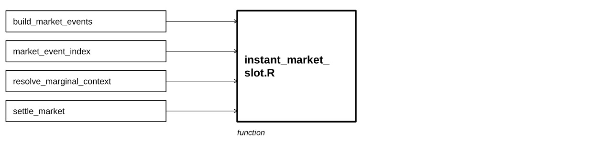

# instant_market_slot.R

**Function** &nbsp;·&nbsp; `30_Simulation/03_Functions/instant_market_slot.R`

## Function

Returns the market interval in which an instant falls: the instant rounded down to the market resolution.

## Called by

- [build_market_events.R](build_market_events.md)
- [market_event_index.R](market_event_index.md)
- [resolve_marginal_context.R](resolve_marginal_context.md)
- [settle_market.R](settle_market.md)

## What it calls, in order of appearance

- Nothing: this piece calls no other piece of the project.

## Input data

- time              : POSIXct vector. The instants.
- market_resolution : Numeric scalar (min). Length of a market interval, parameters$market$market_resolution.

## Output data

- POSIXct vector (UTC), the same length as time: the start of the market interval in which each instant falls.

## Other notes from the file header

### Instants and time steps

A row of Main_df holds the state of the building at its instant and the energy of the time step that ends at that instant. The energy of a row therefore belongs to the market interval of its time step, which is what the column MarketUTC holds (see prepare_market_calendar()). For the last row of an interval, that is the interval that ends at the row's instant. A market clearing is an event at an instant, not a time step. It is keyed by the interval that its instant falls in, which is the first interval whose energy is still ahead of the clearing. This function gives that key, so that every place that locates a market event (the price matrices, the commitment matrices, the economic analysis, the revenue discount) uses the same one.

### Code outline

1. Check the inputs
2. Round each instant down to the market resolution

### Usage instructions

```r
event_slot <- instant_market_slot(Main_df$time[row_index],
  parameters$market$market_resolution)
```

## Diagram



Also available as [instant_market_slot.svg](instant_market_slot.svg).

---

[Back to the code structure index](../Code_Structure.md)
