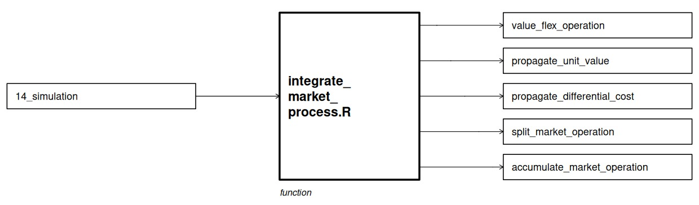

# integrate_market_process.R

**Function** &nbsp;·&nbsp; `30_Simulation/03_Functions/integrate_market_process.R`

## Function

Integrates the result of a single Scheduling or Piloting market execution into Main_df and the market-event output matrices, for the current simulation step. This is the "4. Integrate results" logic shared by the Scheduling and Piloting blocks of 14_simulation.R:

- 4.1 Locate the market row of the current step and the target market intervals covered by this market's control horizon.
- 4.2 Aggregate (SUM) the previous and new commitments per target interval, for:
    - base energy
    - energy with flexibility
    - explicit flexibility
- 4.3 Accumulate the differential energy commitments into these market_commitments matrices:
    - net/buy/sell
    - their _flex counterparts
    - the explicit flexibility buy/sell matrices
- 4.4 Write the absolute *_plan/*_plan_flex_down columns into Main_df. Only two things are committed: the energy of the _plan itinerary and the phase-1 flexibility. The energy of the Recovery Phase is contingent on the service being called, so it is valued by reward_function() to steer the decision but never settled here.
- 4.5 Accumulate the net cash flow of the explicit-flexibility service (both down and up legs, for both Scheduling and Piloting) into market_commitments$Elec_flex_Cost_plan_df and propagate it into Main_df$Elec_flex_commitment_revenue_h; also add the sold/ bought-back totals, on this decision's own row, to Main_df$Elec_flex_sell_revenue_market (income, +=) and Elec_flex_purchase_cost_market (expense, -=).
- 4.6 Accumulate the net cash flow of the energy commitment (the base energy track, for both market families) into market_commitments$Elec_Cost_plan_df and propagate it into Main_df$Elec_market_net_cost_h; also split the same differential into its elementary buy/rebuy/sell/resell operations (split_market_operation()) and add their totals, on this decision's own row, to Main_df$Elec_sell_revenue_market (income, +=) and Elec_purchase_cost_market (expense, -=).
- 4.7 Book the total reward of this decision on its own row: the sum of the per-timestep rewards over the optimization horizon, which is the total the optimizer maximised.

Every money signal follows the same sign convention: income positive, expense negative. full_market_information and market_commitments have one row per market event (not one row per market-resolution interval), while their future-step columns still refer to market-resolution-grid offsets. Column offsets (col_j) are therefore computed against market_time (the full market-resolution grid, used only for this arithmetic), while actual matrix reads/writes are indexed by row_m, the row of the current event within full_market_information/ market_commitments' own (sparse) row set.

## Called by

- [14_simulation.R](14_simulation.md)

## What it calls, in order of appearance

- [value_flex_operation.R](value_flex_operation.md) &nbsp;(2 call sites)
- [propagate_unit_value.R](propagate_unit_value.md)
- [propagate_differential_cost.R](propagate_differential_cost.md)
- [split_market_operation.R](split_market_operation.md)
- [accumulate_market_operation.R](accumulate_market_operation.md)

## Input data

- prefix              : Character. "Sched" or "Pilot". Says whether the target slots count towards economic_analysis$slot's "committed in Scheduling" fraction. It does not select an energy track: both families settle the base energy of the _plan itinerary.
- row_index           : Integer. Current simulation row index (CONT_003).
- results_df          : Data frame. scheduling_results or piloting_results, as returned by run_market_process(), with MarketUTC, the *_plan/*_plan_flex_down columns for the market's control horizon, and the per-timestep Reward of that same window.
- Main_df             : Data frame. The main simulation data frame.
- simulation_control  : Named list. Must contain indexes_global$idx_ctrl and indexes_local$idx_ctrl for the current market.
- market_time         : POSIXct vector. Sorted unique MarketUTC intervals on the full market-resolution grid; used only to compute future-step column offsets (col_j), not as the matrices' row set.
- full_market_information : Named list of 13 market-event price data frames (read-only), as built by 11_full_market_information_setup.R.
- market_commitments  : Named list of 12 market-event output data frames, as built by 12_market_commitments_setup.R.
- economic_analysis   : Named list of economic-analysis accumulators (market, slot and the index sub-list), as built by 13_economic_analysis_setup.R.

## Output data

- Named list with: Main_df            : Data frame. Updated with the absolute *_plan/ *_plan_flex_down columns, the propagated Elec_market_net_cost_h and Elec_flex_commitment_revenue_h columns, and the "_market" lump-sum columns on row_index - Elec_purchase_cost_market / Elec_sell_revenue_market and Elec_flex_purchase_cost_market / Elec_flex_sell_revenue_market, all four regardless of prefix (income positive, expense negative) - plus Reward, the total reward of this decision, also on row_index. market_commitments : Named list. Updated in place with the differential energy and cost commitments of this market execution. economic_analysis  : Named list. Updated in place with this market execution's elementary operations, on the economic_analysis$market row that owns each target slot and on the economic_analysis$slot row of that slot.

## Other notes from the file header

### Code outline

1. Market row and target market intervals

1b. Attribution of each target slot to an economic_analysis$market row

2. Per-interval commitments before/after the market (SUM aggregation)
3. Accumulate the differential commitments in the output matrices (also resolves the explicit-flexibility net cash flow per interval)
4. Absolute update of Main_df

4b. Explicit flexibility cost/revenue (Scheduling and Piloting alike)

5. Differential cost of the energy commitment (base energy track, for both market families)

5b. Reward of this decision, totalled on its own row

### Usage instructions

```r
result             <- integrate_market_process(prefix, row_index, results_df, Main_df, simulation_control, market_time, full_market_information, market_commitments, economic_analysis)
```

Main_df            <- result$Main_df market_commitments <- result$market_commitments economic_analysis  <- result$economic_analysis

## Diagram



Also available as [integrate_market_process.svg](integrate_market_process.svg).

---

[Back to the code structure index](../Code_Structure.md)
