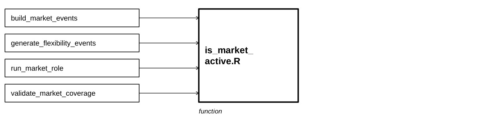

# is_market_active.R

**Function** &nbsp;·&nbsp; `30_Simulation/03_Functions/is_market_active.R`

## Function

Determines whether a market configuration value represents an active market.

## Called by

- [build_market_events.R](build_market_events.md)
- [generate_flexibility_events.R](generate_flexibility_events.md)
- [run_market_role.R](run_market_role.md)
- [validate_market_coverage.R](validate_market_coverage.md)

## What it calls, in order of appearance

- Nothing: this piece calls no other piece of the project.

## Input data

- market_name_raw : Any scalar value to evaluate.

## Output data

- Logical. TRUE if market is active, FALSE otherwise.

## Other notes from the file header

### Usage instructions

```r
is_market_active(market_name_raw)
```

### Code outline

1. Trim the name and decide: anything that is not empty, not NA and not "0" marks an active market.

## Diagram



Also available as [is_market_active.svg](is_market_active.svg).

---

[Back to the code structure index](../Code_Structure.md)
