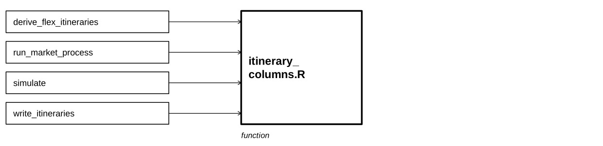

# itinerary_columns.R

**Function** &nbsp;·&nbsp; `30_Simulation/03_Functions/itinerary_columns.R`

## Function

Returns the columns of one itinerary of the assets: the columns of every variable that the variable registry of each type of model of the assets of the system (Simulation_Variables_<type>.txt) expands into the four itineraries, with the suffix of the one asked for. A type that no asset of the registry has adds no column. A column that several types declare is named once. The itineraries are:

- exec           : what was executed
- plan           : the plan
- plan_flex_down : the downward flexibility itinerary
- plan_flex_up   : the upward flexibility itinerary

The columns are built from the variables, not found by their suffix, so a column that only ends like an itinerary is never taken for one. The commitments (Elec_flex_down_plan, Elec_flex_up_plan) and the phase codes (Flex_phase_down_plan, Flex_phase_up_plan) end in "_plan" but belong to no itinerary.

## Called by

- [derive_flex_itineraries.R](derive_flex_itineraries.md)
- [run_market_process.R](run_market_process.md)
- [simulate.R](simulate.md)
- [write_itineraries.R](write_itineraries.md)

## What it calls, in order of appearance

- Nothing: this piece calls no other piece of the project.

## Input data

- itinerary  : Character scalar. One of "exec", "plan", "plan_flex_down" or "plan_flex_up".
- parameters : List. Uses itinerary_variables, a list with one element per type of model, each with the variables of its registry with scenario == "yes", in registry order, and assets, the asset registry, whose asset_type selects the types.

## Output data

- Character vector. The columns of the itinerary of every type of model that an asset of the system has, once each, in registry order and then in the order of the types.

## Other notes from the file header

### Code outline

1. Check the itinerary
2. Build its columns

### Usage instructions

```r
plan_cols <- itinerary_columns("plan", parameters)
```

## Diagram



Also available as [itinerary_columns.svg](itinerary_columns.svg).

---

[Back to the code structure index](../Code_Structure.md)
