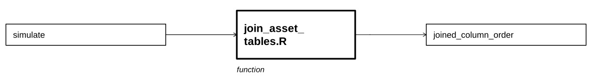

# join_asset_tables.R

**Function** &nbsp;·&nbsp; `30_Simulation/03_Functions/join_asset_tables.R`

## Function

Joins, over some rows, Main_df and the table of an asset into one plain data frame: the chunk of an asset that the functions written for the joined table of a single asset work on. Main_df holds what is common to every asset and the balances of the system; the table of the asset, assets[[asset_id]]$df, holds the columns of the asset, one row per row of Main_df. The joined table holds the columns of both, each once, in the order of column_order (the order of 02_Needed_cols.csv). A column held by both tables is taken from the table of the asset: the net electricity of the system in an itinerary (with a single asset it is the same as the sum that Main_df holds), or an input of the type, which has the same values as in Main_df. The execution joins Main_df with the table of one asset at a time (assets[asset_id], a list of one entry). The view of an asset in the piece of a market (piece_asset_view()) joins the table of the system of the piece with the table of that asset. The functions that work on the joined table read the columns of the asset and those of the system from the same rows.

## Called by

- [simulate.R](simulate.md)

## What it calls, in order of appearance

- [joined_column_order.R](joined_column_order.md)

## Input data

- Main_df      : Data table. The common and system columns.
- assets       : Named list, one entry per asset, each with df, the table of the asset (a data table).
- rows         : Integer vector. The rows to join, rows of Main_df and of the table of the asset alike.
- column_order : Character vector. The order of the columns of the joined table (parameters$joined_cols). A column not in it goes after those that are.

## Output data

- Data frame (a plain data frame, not a data table), one row per element of rows, with the columns of Main_df and of the asset.

## Other notes from the file header

### Code outline

1. Check that there is a single asset
2. The columns and the table each one is read from
3. Build the joined data frame

### Usage instructions

```r
period_chunk <- join_asset_tables(
  Main_df      = Main_df,
  assets       = assets[asset_id],
  rows         = simulation_control$indexes_global$idx_period,
  column_order = parameters$joined_cols
  )
```

### Exceptions and special cases

- With no asset, or with more than one, it stops: the tables of several assets are not joined into one.

## Diagram



Also available as [join_asset_tables.svg](join_asset_tables.svg).

---

[Back to the code structure index](../Code_Structure.md)
