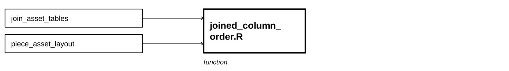

# joined_column_order.R

**Function** &nbsp;·&nbsp; `30_Simulation/03_Functions/joined_column_order.R`

## Function

Gives the order of the columns of a table that joins the table of the system and the table of an asset. Every column appears once: first those of column_order, in its order, and then the others, in the order of the columns of the system followed by those of the asset. It keeps the rule of the order in one place, for every function that builds a joined table.

## Called by

- [join_asset_tables.R](join_asset_tables.md)
- [piece_asset_layout.R](piece_asset_layout.md)

## What it calls, in order of appearance

- Nothing: this piece calls no other piece of the project.

## Input data

- system_columns : Character vector. The columns of the system.
- asset_columns  : Character vector. The columns of the asset, without the key time.
- column_order   : Character vector. The preferred order of the columns (parameters$joined_cols). A column not in it goes after those that are.

## Output data

- Character vector. The columns of both tables, each once, in the order of the joined table.

## Other notes from the file header

### Code outline

1. Order the columns

### Usage instructions

```r
ordered <- joined_column_order(
  system_columns = names(Main_df),
  asset_columns  = asset_columns,
  column_order   = parameters$joined_cols
  )
```

## Diagram



Also available as [joined_column_order.svg](joined_column_order.svg).

---

[Back to the code structure index](../Code_Structure.md)
