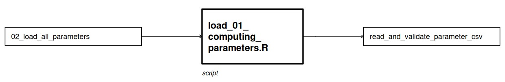

# load_01_computing_parameters.R

**Script** &nbsp;·&nbsp; `30_Simulation/04_Scripts/load_01_computing_parameters.R`

## Function

Loads the computing parameters from 01_computing_parameters.csv, validates them against Validation_01_computing_parameters.csv, and stores the result in parameters$computing. These are the numerical constants of the simulation engine itself: the resolution of the master time grid every dataframe is built on, the tolerance below which a market slot's planned energy is treated as zero, and the time margin the flexibility event generator keeps between events. They are loaded before any other configuration file, because assemble_main_df.R needs the master resolution to build Main_df. Sourced from 02_load_all_parameters.R.

## Called by

- [02_load_all_parameters.R](02_load_all_parameters.md)

## What it calls, in order of appearance

- [read_and_validate_parameter_csv.R](read_and_validate_parameter_csv.md)

## Input data

- paths$computing_parameters_file : path of 01_computing_parameters.csv, resolved by 01_initialization.R.
- Its validation table, Validation_01_computing_parameters.csv, read alongside it.
- parameters : the list being assembled, to which this script adds one sub-list.

## Output data

- parameters$computing, populated. Nothing else is modified.

## Other notes from the file header

### Code outline

1. Read the file and validate every value against its own validation table.
2. Store the result in parameters$computing.

### Usage instructions

Not called: sourced by 02_load_all_parameters.R, which supplies paths and parameters and takes the updated parameters back.

## Diagram

Also available as [load_01_computing_parameters.svg](load_01_computing_parameters.svg).

---

[Back to the code structure index](../Code_Structure.md)
