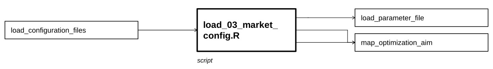

# load_03_market_config.R

**Script** &nbsp;·&nbsp; `30_Simulation/04_Scripts/load_03_market_config.R`

## Function

Loads market configuration from 03_Market_config.csv, which also holds the six limits of the flexibility price emulation, used by both the basic and the complex modes of prepare_flexibility_prices():

- Max_flex_periods_day
- Max_flex_com_price
- Max_flex_exec_price
- Max_flex_period_duration
- Max_flex_probability_down
- Max_flex_probability_up

It validates the values against the parameter catalogue, checks that both optimization horizons are a whole number of market intervals, resolves the raw scheduling/piloting aim codes (O/E/O+F/E+F) to internal text labels ("energy"/"flexibility"/"operation"/"operationflex") via map_optimization_aim(). Stores the result in parameters$market. Sourced from load_all_parameters(). Requires parameters$optimization to be already loaded.

## Called by

- [load_configuration_files.R](load_configuration_files.md)

## What it calls, in order of appearance

- [load_parameter_file.R](load_parameter_file.md)
- [map_optimization_aim.R](map_optimization_aim.md) &nbsp;(2 call sites)

## Input data

- paths$market_file : path of 03_Market_config.csv, resolved by initialize_simulator().
- parameters : the list being assembled, to which this script adds one sub-list.

## Output data

- parameters$market, populated. Nothing else is modified.

## Other notes from the file header

### Code outline

1. Read the file and validate every value.
2. Translate each aim letter into its internal name.
3. Check the horizons against the market resolution.

### Usage instructions

Not called: sourced by load_all_parameters(), which supplies paths and parameters and takes the updated parameters back.

## Diagram

Also available as [load_03_market_config.svg](load_03_market_config.svg).

---

[Back to the code structure index](../Code_Structure.md)
