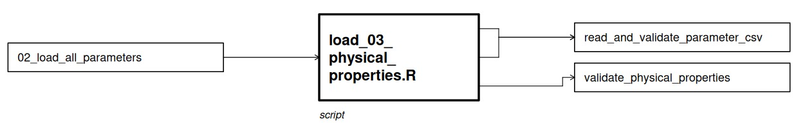

# load_03_physical_properties.R

**Script** &nbsp;·&nbsp; `30_Simulation/04_Scripts/load_03_physical_properties.R`

## Function

Loads physical properties from 03_Physical_properties.csv, validates the values against Parameter_config.csv, applies the domain-specific validate_physical_properties() check against the reference values of Validation_03_Physical_properties.csv, and stores the result in parameters$physical_properties. Sourced from 02_load_all_parameters.R.

## Called by

- [02_load_all_parameters.R](02_load_all_parameters.md)

## What it calls, in order of appearance

- [read_and_validate_parameter_csv.R](read_and_validate_parameter_csv.md) &nbsp;(2 call sites)
- [validate_physical_properties.R](validate_physical_properties.md)

## Input data

- paths$physical_properties_file : path of 03_Physical_properties.csv, resolved by 01_initialization.R.
- Its validation table, Validation_03_Physical_properties.csv, read alongside it.
- parameters : the list being assembled, to which this script adds one sub-list.

## Output data

- parameters$physical_properties, populated. Nothing else is modified.

## Other notes from the file header

### Code outline

1. Read the file and validate every value.
2. Check the properties against their physical ranges.
3. Store the result in parameters$physical_properties.

### Usage instructions

Not called: sourced by 02_load_all_parameters.R, which supplies paths and parameters and takes the updated parameters back.

## Diagram

Also available as [load_03_physical_properties.svg](load_03_physical_properties.svg).

---

[Back to the code structure index](../Code_Structure.md)
