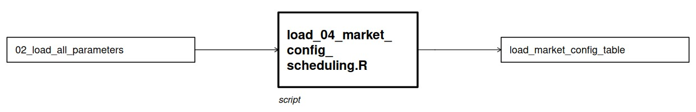

# load_04_market_config_scheduling.R

**Script** &nbsp;·&nbsp; `30_Simulation/04_Scripts/load_04_market_config_scheduling.R`

## Function

Loads the scheduling market configuration table from 04_Market_config_scheduling.csv, validates required columns and non-empty content, and stores the data frame in parameters$market_config_scheduling. Sourced from 02_load_all_parameters.R.

## Called by

- [02_load_all_parameters.R](02_load_all_parameters.md)

## What it calls, in order of appearance

- [load_market_config_table.R](load_market_config_table.md)

## Input data

- paths$market_config_scheduling_file : path of 04_Market_config_scheduling.csv, resolved by 01_initialization.R.
- parameters : the list being assembled, to which this script adds one sub-list.

## Output data

- parameters$market_config_scheduling, populated. Nothing else is modified.

## Other notes from the file header

### Code outline

1. Read the table with the shared market table reader.
2. Check the required columns and that it is not empty.
3. Store the table in parameters$market_config_scheduling.

### Usage instructions

Not called: sourced by 02_load_all_parameters.R, which supplies paths and parameters and takes the updated parameters back.

## Diagram

Also available as [load_04_market_config_scheduling.svg](load_04_market_config_scheduling.svg).

---

[Back to the code structure index](../Code_Structure.md)
