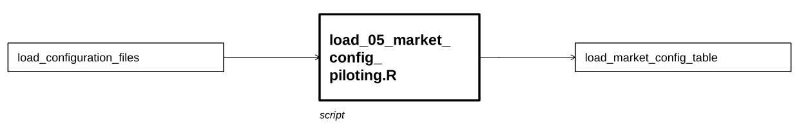

# load_05_market_config_piloting.R

**Script** &nbsp;·&nbsp; `30_Simulation/04_Scripts/load_05_market_config_piloting.R`

## Function

Loads the piloting market configuration table from 05_Market_config_piloting.csv, validates required columns and non-empty content, and stores the data frame in parameters$market_config_piloting. Sourced from load_all_parameters().

## Called by

- [load_configuration_files.R](load_configuration_files.md)

## What it calls, in order of appearance

- [load_market_config_table.R](load_market_config_table.md)

## Input data

- paths$market_config_piloting_file : path of 05_Market_config_piloting.csv, resolved by initialize_simulator().
- parameters : the list being assembled, to which this script adds one sub-list.

## Output data

- parameters$market_config_piloting, populated. Nothing else is modified.

## Other notes from the file header

### Code outline

1. Read the table with the shared market table reader.
2. Check the required columns and that it is not empty.
3. Store the table in parameters$market_config_piloting.

### Usage instructions

Not called: sourced by load_all_parameters(), which supplies paths and parameters and takes the updated parameters back.

## Diagram

Also available as [load_05_market_config_piloting.svg](load_05_market_config_piloting.svg).

---

[Back to the code structure index](../Code_Structure.md)
