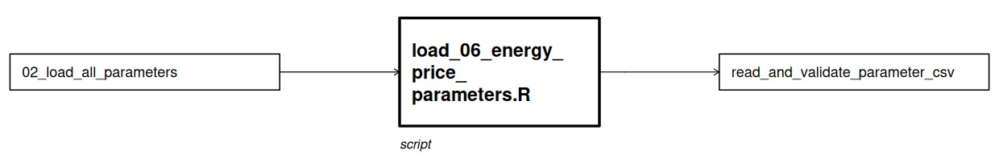

# load_06_energy_price_parameters.R

**Script** &nbsp;·&nbsp; `30_Simulation/04_Scripts/load_06_energy_price_parameters.R`

## Function

Loads energy market price discount/premium parameters from 06_Energy_price_parameters.csv, validates values against Parameter_config.csv, and stores the result in parameters$energy_price. These parameters apply only to the four energy buy/sell price signals (Elec_unit_cost_import_buy/sell, _export_buy/sell), not to flexibility. They are read by:

- 10_energy_price_signals_setup.R
- 11_full_market_information_setup.R

which derive the four energy signals from them. Sourced from 02_load_all_parameters.R.

## Called by

- [02_load_all_parameters.R](02_load_all_parameters.md)

## What it calls, in order of appearance

- [read_and_validate_parameter_csv.R](read_and_validate_parameter_csv.md)

## Input data

- paths$energy_price_file : path of 06_Energy_price_parameters.csv, resolved by 01_initialization.R.
- parameters : the list being assembled, to which this script adds one sub-list.

## Output data

- parameters$energy_price, populated. Nothing else is modified.

## Other notes from the file header

### Code outline

1. Read the file and validate every value.
2. Store the result in parameters$energy_price.

### Usage instructions

Not called: sourced by 02_load_all_parameters.R, which supplies paths and parameters and takes the updated parameters back.

## Diagram

Also available as [load_06_energy_price_parameters.svg](load_06_energy_price_parameters.svg).

---

[Back to the code structure index](../Code_Structure.md)
