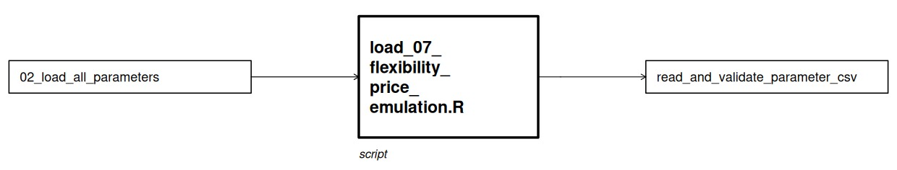

# load_07_flexibility_price_emulation.R

**Script** &nbsp;·&nbsp; `30_Simulation/04_Scripts/load_07_flexibility_price_emulation.R`

## Function

Loads the market-aware flexibility generation parameters from 07_Flexibility_price_emulation_parameters.csv:

- Max_shift_hours
- P_advance
- P_delay
- P_event_base
- decay_rate

validates the values against Parameter_config.csv, and stores the result in parameters$flexibility_price_emulation. Only consumed by 09_flexibility_price_emulation.R when Complex_Market_Config == "yes". Sourced from 02_load_all_parameters.R.

## Called by

- [02_load_all_parameters.R](02_load_all_parameters.md)

## What it calls, in order of appearance

- [read_and_validate_parameter_csv.R](read_and_validate_parameter_csv.md)

## Input data

- paths$flexibility_price_emulation_file : path of 07_Flexibility_price_emulation_parameters.csv, resolved by 01_initialization.R.
- parameters : the list being assembled, to which this script adds one sub-list.

## Output data

- parameters$flexibility_price_emulation, populated. Nothing else is modified.

## Other notes from the file header

### Code outline

1. Read the file and validate every value.
2. Store the result in parameters$flexibility_price_emulation.

### Usage instructions

Not called: sourced by 02_load_all_parameters.R, which supplies paths and parameters and takes the updated parameters back.

## Diagram

Also available as [load_07_flexibility_price_emulation.svg](load_07_flexibility_price_emulation.svg).

---

[Back to the code structure index](../Code_Structure.md)
