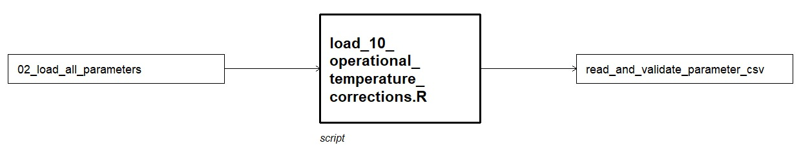

# load_10_operational_temperature_corrections.R

**Script** &nbsp;·&nbsp; `30_Simulation/04_Scripts/load_10_operational_temperature_corrections.R`

## Function

Loads the operational temperature corrections from 10_Operational_temperature_corrections.csv, validates values against Parameter_config.csv, and stores them in parameters$operational_temperature_corrections: the parameters that shape the reference temperature curves (anticipation of the service period, seasonal correction of the comfort band, and detection of the heating and cooling seasons). Sourced from 02_load_all_parameters.R.

## Called by

- [02_load_all_parameters.R](02_load_all_parameters.md)

## What it calls, in order of appearance

- [read_and_validate_parameter_csv.R](read_and_validate_parameter_csv.md)

## Input data

- paths$operational_temperature_corrections_file : path of 10_Operational_temperature_corrections.csv, resolved by 01_initialization.R.
- parameters : the list being assembled.

## Output data

- parameters$operational_temperature_corrections, with the eight corrections. Nothing else is modified.

## Other notes from the file header

### Code outline

1. Read the file and validate every value.
2. Store the result in parameters$operational_temperature_corrections.

### Usage instructions

Not called: sourced by 02_load_all_parameters.R, which supplies paths and parameters and takes the updated parameters back.

## Diagram

Also available as [load_10_operational_temperature_corrections.svg](load_10_operational_temperature_corrections.svg).

---

[Back to the code structure index](../Code_Structure.md)
