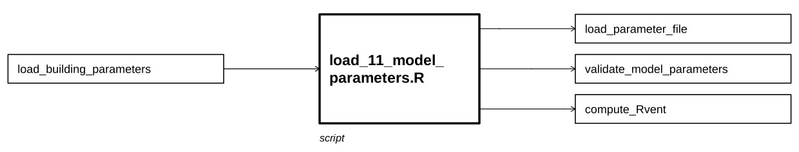

# load_11_model_parameters.R

**Script** &nbsp;·&nbsp; `30_Simulation/05_Models/01_Building/04_Scripts/load_11_model_parameters.R`

## Function

Loads model parameters from 11_Model_parameters.csv, validates them against the parameter catalogue, applies the domain-specific validate_model_parameters() check, computes Rvent parameters via compute_Rvent(), and stores the result in parameters$model. Sourced from load_building_parameters(), which supplies the paths of the asset. Requires parameters$physical_properties to be already loaded.

## Called by

- [load_building_parameters.R](load_building_parameters.md)

## What it calls, in order of appearance

- [load_parameter_file.R](load_parameter_file.md)
- [validate_model_parameters.R](validate_model_parameters.md)
- [compute_Rvent.R](compute_Rvent.md)

## Input data

- paths$model_file : path of 11_Model_parameters.csv, in the configuration folder of the asset, as build_asset_paths() gives it.
- parameters : the list being assembled, to which this script adds one sub-list.

## Output data

- parameters$model, populated. Nothing else is modified.
- load_building_parameters() gathers the group into the groups of the building.

## Other notes from the file header

### Code outline

1. Read the file and validate every value against the parameter catalogue.
2. Check the building volume (validate_model_parameters()).
3. Resolve the ventilation resistance of each regime.
4. Store the result in parameters$model.

### Usage instructions

Not called: sourced by load_building_parameters(), which supplies paths, the paths of the asset, and parameters, and takes the updated parameters back.

## Diagram

Also available as [load_11_model_parameters.svg](load_11_model_parameters.svg).

---

[Back to the code structure index](../Code_Structure.md)
