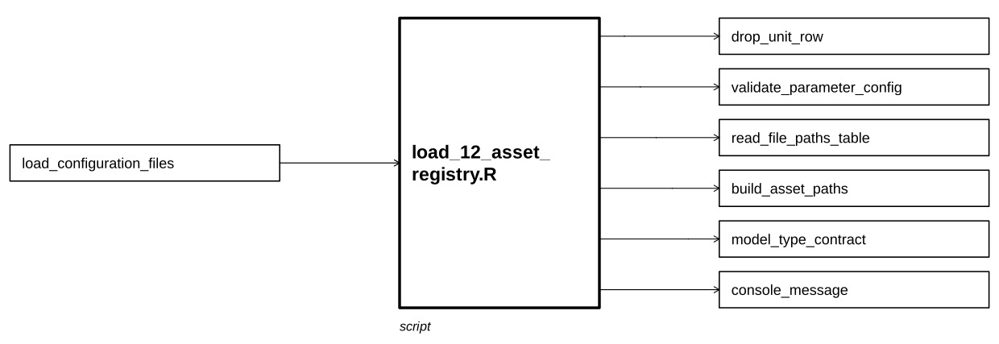

# load_12_asset_registry.R

**Script** &nbsp;·&nbsp; `30_Simulation/04_Scripts/load_12_asset_registry.R`

## Function

Loads the asset registry, 12_Asset_registry.csv, and gathers the parameters of each asset into parameters$assets, one entry per asset, named by its asset id.

## Called by

- [load_configuration_files.R](load_configuration_files.md)

## What it calls, in order of appearance

- [drop_unit_row.R](drop_unit_row.md)
- [validate_parameter_config.R](validate_parameter_config.md)
- [read_file_paths_table.R](read_file_paths_table.md)
- [build_asset_paths.R](build_asset_paths.md)
- [model_type_contract.R](model_type_contract.md)
- [console_message.R](console_message.md)

## Input data

- paths : List. The paths of the simulation, as set by initialize_simulator(). It holds asset_registry_file, the path of 12_Asset_registry.csv, and config_path, the configuration folder.
- validation_config : the parameter catalogue, as load_parameter_catalogue() returns it.
- bounding_validation_config : the content of Validation_bounding_simulation.csv.
- parameters : the list being assembled, with the system parameters already loaded, among them:
    - physical_properties

## Output data

- parameters$assets : named list, one entry per asset of the registry, named by its asset id. The entry of a Building holds:
    - asset_id
    - asset_type
    - model
    - operational_temperature_corrections
    - setpoint_modes
    - use_patterns
    - comfort
- One LOAD line per asset is written to the console, with its type and the number of files it loaded.

## Other notes from the file header

### The assets

The system operates its assets behind a single connection point with the grid. Each row of the registry is an asset: its id and its type of model. Each asset has its own configuration folder, named by its id inside the folder of the assets, with the files of its type of model (see build_asset_paths()). The parameters of an asset are loaded by the operation load_parameters of the contract of its type (see model_type_contract()), and gathered here into its entry of parameters$assets. A Building holds the groups:

- model
- operational_temperature_corrections
- setpoint_modes
- use_patterns
- comfort, the comfort weight and the comfort bands of the building

Every operation of the type of model of an asset receives the entry of its asset (see model_type_contract()). The registry holds one or more assets. The assets share the weather, the markets and the prices of the system.

### Validation

The run stops when:

- the registry lacks one of its columns, or holds no asset;
- a value breaks its rule of the parameter catalogue;
- an asset id is repeated, or is not its type followed by an underscore and three digits (for example Building_001);
- a type of model of the file paths table is not an asset type of the catalogue;
- the folder of an asset, or one of its files, does not exist.

### Code outline

1. Read the registry, dropping its units row
2. Validate each asset
3. Load the parameters of each asset through the contract of its type

### Usage instructions

Not called: sourced by load_configuration_files.R, which supplies paths, validation_config, bounding_validation_config and parameters.

## Diagram

Also available as [load_12_asset_registry.svg](load_12_asset_registry.svg).

---

[Back to the code structure index](../Code_Structure.md)
