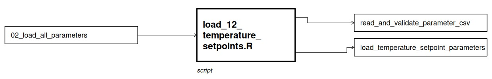

# load_12_temperature_setpoints.R

**Script** &nbsp;·&nbsp; `30_Simulation/04_Scripts/load_12_temperature_setpoints.R`

## Function

Loads 12_Temperature_Setpoints.csv, validates every value against Parameter_config.csv, and structures it with load_temperature_setpoint_parameters() into parameters$control. These are the ranges the optimizer chooses each setpoint from when control_type is setpoints.

## Called by

- [02_load_all_parameters.R](02_load_all_parameters.md)

## What it calls, in order of appearance

- [read_and_validate_parameter_csv.R](read_and_validate_parameter_csv.md)
- [load_temperature_setpoint_parameters.R](load_temperature_setpoint_parameters.md)

## Input data

- paths$temperature_setpoints_file : path of 12_Temperature_Setpoints.csv, resolved by 01_initialization.R.
- parameters : the list being assembled.

## Output data

- parameters$control, with these parameters added to it.

## Other notes from the file header

### Code outline

1. Read the file and validate every value.
2. Structure it with load_temperature_setpoint_parameters() and store it in parameters$control.

### Usage instructions

Not called: sourced by 02_load_all_parameters.R, which supplies paths and parameters and takes the updated parameters back.

## Diagram

Also available as [load_12_temperature_setpoints.svg](load_12_temperature_setpoints.svg).

---

[Back to the code structure index](../Code_Structure.md)
