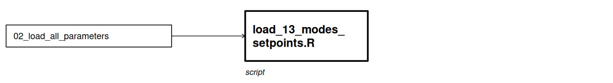

# load_13_modes_setpoints.R

**Script** &nbsp;·&nbsp; `30_Simulation/04_Scripts/load_13_modes_setpoints.R`

## Function

Loads the setpoint-modes table from 13_Modes_setpoints.csv and stores it in parameters$setpoint_modes. Drops a leading "text"/unit placeholder row if present (same convention as load_market_config_table.R/load_14_use_patterns.R). Validates:

- the required columns
- the absence of NA values
- integer mode codes
- consecutive mode numbering starting at 1

Sourced from 02_load_all_parameters.R.

## Called by

- [02_load_all_parameters.R](02_load_all_parameters.md)

## What it calls, in order of appearance

- Nothing: this piece calls no other piece of the project.

## Input data

- paths$setpoint_mode_file : path of 13_Modes_setpoints.csv, resolved by 01_initialization.R.
- parameters : the list being assembled, to which this script adds one sub-list.

## Output data

- parameters$setpoint_modes, populated. Nothing else is modified.

## Other notes from the file header

### Code outline

1. Read the table, dropping the unit placeholder row.
2. Check the columns, the absence of NA, and that the mode codes are consecutive integers from one.
3. Store the table in parameters$setpoint_modes.

### Usage instructions

Not called: sourced by 02_load_all_parameters.R, which supplies paths and parameters and takes the updated parameters back.

## Diagram

Also available as [load_13_modes_setpoints.svg](load_13_modes_setpoints.svg).

---

[Back to the code structure index](../Code_Structure.md)
