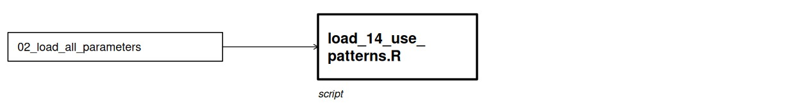

# load_14_use_patterns.R

**Script** &nbsp;·&nbsp; `30_Simulation/04_Scripts/load_14_use_patterns.R`

## Function

Loads occupancy use patterns from 14_Use_Patterns.csv, validates both tables (TYPE and MONTH blocks), and stores them in parameters$use_patterns. Sourced from 02_load_all_parameters.R.

## Called by

- [02_load_all_parameters.R](02_load_all_parameters.md)

## What it calls, in order of appearance

- Nothing: this piece calls no other piece of the project.

## Input data

- paths$use_patterns_file : path of 14_Use_Patterns.csv, resolved by 01_initialization.R.
- parameters : the list being assembled, to which this script adds one sub-list.

## Output data

- parameters$use_patterns, populated. Nothing else is modified.

## Other notes from the file header

### Code outline

1. Read the table, dropping the unit placeholder row.
2. Check the required columns are there.
3. Store the table in parameters$use_patterns.

### Usage instructions

Not called: sourced by 02_load_all_parameters.R, which supplies paths and parameters and takes the updated parameters back.

## Diagram

Also available as [load_14_use_patterns.svg](load_14_use_patterns.svg).

---

[Back to the code structure index](../Code_Structure.md)
