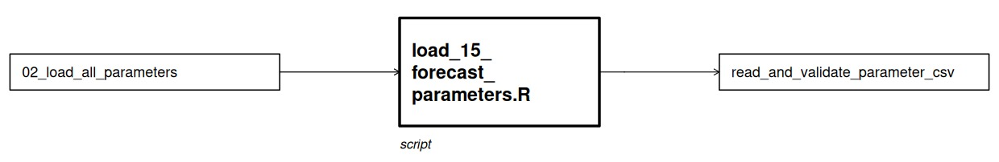

# load_15_forecast_parameters.R

**Script** &nbsp;·&nbsp; `30_Simulation/04_Scripts/load_15_forecast_parameters.R`

## Function

Loads forecast parameters from 15_Forecast_parameters.csv, validates values against Parameter_config.csv, reads weather_forecast_type directly as text ("accurate" or "inaccurate"), and stores the result in parameters$forecast. Its validity is already enforced by Parameter_config.csv (Options type, Error level, "accurate,inaccurate") inside read_and_validate_parameter_csv(), so it is not re-checked here. Sourced from 02_load_all_parameters.R.

## Called by

- [02_load_all_parameters.R](02_load_all_parameters.md)

## What it calls, in order of appearance

- [read_and_validate_parameter_csv.R](read_and_validate_parameter_csv.md)

## Input data

- paths$forecast_file : path of 15_Forecast_parameters.csv, resolved by 01_initialization.R.
- parameters : the list being assembled, to which this script adds one sub-list.

## Output data

- parameters$forecast, populated. Nothing else is modified.

## Other notes from the file header

### Code outline

1. Read the file and validate every value.
2. Store the result in parameters$forecast.

### Usage instructions

Not called: sourced by 02_load_all_parameters.R, which supplies paths and parameters and takes the updated parameters back.

## Diagram

Also available as [load_15_forecast_parameters.svg](load_15_forecast_parameters.svg).

---

[Back to the code structure index](../Code_Structure.md)
