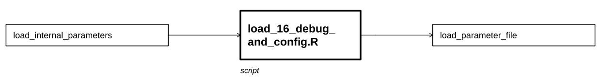

# load_16_debug_and_config.R

**Script** &nbsp;·&nbsp; `30_Simulation/04_Scripts/load_16_debug_and_config.R`

## Function

Loads debug and configuration parameters from 16_Debug_and_config.csv, validates them against the parameter catalogue, turns verbose into a logical switch, and stores the result in parameters$debug_and_config. Sourced from load_all_parameters().

## Called by

- [load_internal_parameters.R](load_internal_parameters.md)

## What it calls, in order of appearance

- [load_parameter_file.R](load_parameter_file.md)

## Input data

- paths$debug_and_config_file : path of 16_Debug_and_config.csv, resolved by initialize_simulator().
- parameters : the list being assembled, to which this script adds one sub-list.

## Output data

- parameters$debug_and_config, populated. Nothing else is modified.

## Other notes from the file header

### Code outline

1. Read the file and validate every value.
2. Turn verbose into a logical switch.
3. Store the result in parameters$debug_and_config.

### Usage instructions

Not called: sourced by load_all_parameters(), which supplies paths and parameters and takes the updated parameters back.

## Diagram

Also available as [load_16_debug_and_config.svg](load_16_debug_and_config.svg).

---

[Back to the code structure index](../Code_Structure.md)
