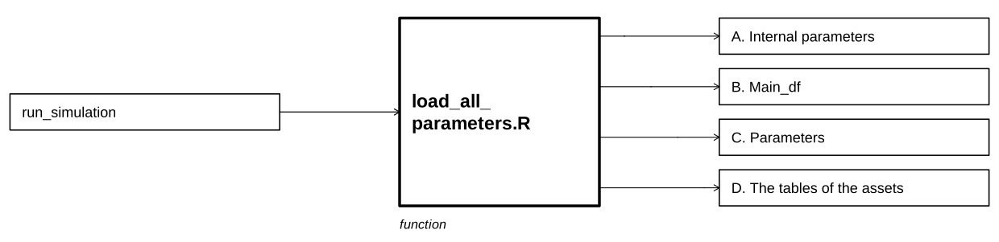

# load_all_parameters.R

**Function** &nbsp;·&nbsp; `30_Simulation/03_Functions/load_all_parameters.R`

## Function

Master parameter-loading function. It reads the parameter catalogue, loads the internal parameters (load_internal_parameters.R), assembles and validates Main_df, loads every configuration file (load_configuration_files.R), checks the relations between parameters, and builds the table of each asset of the asset registry. Every file is validated against the parameter catalogue as it is read.

## Called by

- [run_simulation.R](run_simulation.md)

## What it calls, in order of appearance

- [load_parameter_catalogue.R](load_parameter_catalogue.md)
- [load_internal_parameters.R](load_internal_parameters.md)
- [assemble_main_df.R](assemble_main_df.md)
- [validate_Main_df.R](validate_Main_df.md)
- [load_configuration_files.R](load_configuration_files.md)
- [drop_unit_row.R](drop_unit_row.md)
- [read_file_paths_table.R](read_file_paths_table.md)
- [validate_parameter_relations.R](validate_parameter_relations.md)
- [model_type_contract.R](model_type_contract.md)
- [validate_asset_df.R](validate_asset_df.md)
- [console_message.R](console_message.md)
- [copy_asset_inputs.R](copy_asset_inputs.md)

## Blocks

The code of load_all_parameters.R is split into 4 blocks, each made of numbered steps. A block that calls more than six items is split again into consecutive steps.

- [A. Internal parameters](load_all_parameters__A.md) &nbsp;(steps 1 to 2)
- [B. Main_df](load_all_parameters__B.md) &nbsp;(steps 3 to 4)
- [C. Parameters](load_all_parameters__C.md) &nbsp;(steps 5 to 7)
- [D. The tables of the assets](load_all_parameters__D.md) &nbsp;(step 8)

## Input data

- paths : List. The paths of the simulation: the configuration files, the data files and the output folder, as built by initialize_simulator().

## Output data

- Named list with:
- Main_df    : Data frame. Main simulation data frame (full year, not subsetted), with the common columns and those of the system.
- assets     : Named list, one entry per asset of the registry, named by its asset id. Each entry is a list with df, the table of the asset (full year, not subsetted).
- parameters : List with these sub-lists:
    - computing
    - physical_properties
    - needed_cols
    - control
    - optimization
    - market
    - market_config_scheduling
    - market_config_piloting
    - reward
    - forecast
    - energy_price
    - flexibility_price_emulation
    - debug_and_config
    - assets : one entry per asset of 12_Asset_registry.csv, named by its asset id, with the groups of the asset. A Building holds model, use_patterns, setpoint_modes and operational_temperature_corrections.
- One DATA line per asset is written to the console, with the size of its table. The scripts it sources and the validations write no other line when all goes well.

## Other notes from the file header

### The data of the system and of its assets

Main_df holds what is common to every asset (the time grid, the weather, the prices) and the balances of the system. The columns of each asset are in its own table, assets[[asset_id]]$df, one row per row of Main_df, with the column time as the key of its rows. The table of a building is generated from the variable registry of the building.

### The scripts it sources

load_internal_parameters.R, assemble_main_df.R and load_configuration_files.R are scripts: each is sourced into the environment of this function, where it finds paths, validation_config and parameters and leaves what it loads. Nothing is created in the global environment.

### Code outline

A. Internal parameters

1. Validation configuration files (the parameter catalogue and the validation tables of 00_Validation/)
2. Computing parameters, physical properties, debug and configuration, and needed columns, via load_internal_parameters.R

B. Main_df

3. Assemble Main_df via assemble_main_df.R (Meteo_df/ Energy_Prices_df + synthetic dataframes)
4. Validate its structure (validate_Main_df())

C. Parameters

5. Every configuration file, from 01_Optimization_parameters.csv to 15_Forecast_parameters.csv, and the asset registry, via load_configuration_files.R
6. Check the relations between parameters (validate_parameter_relations())
7. Recalculate T_ext_24h from previous-day averages

D. The tables of the assets

8. Build the table of each asset on the grid of Main_df, through the operation new_table of its type of model, and validate it (validate_asset_df()), and copy into it the columns of Main_df its type declares as inputs (copy_asset_inputs())
9. Return Main_df, the assets and parameters

### Usage instructions

```r
loaded <- load_all_parameters(
  paths = sim$paths
  )
```

loaded$Main_df loaded$assets$Building_001$df loaded$parameters$control

## Diagram



Also available as [load_all_parameters.svg](load_all_parameters.svg).

---

[Back to the code structure index](../Code_Structure.md)
