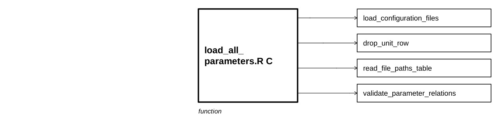

# load_all_parameters.R &mdash; C. Parameters

Block C of [load_all_parameters.R](load_all_parameters.md), steps 5 to 7.

## Steps

- **5.** Configuration files &mdash; [load_configuration_files.R](load_configuration_files.md)
- **6.** Relations between parameters &mdash; [drop_unit_row.R](drop_unit_row.md), [read_file_paths_table.R](read_file_paths_table.md), [validate_parameter_relations.R](validate_parameter_relations.md)
- **7.** Recalculate T_ext_24h &mdash; inline code in load_all_parameters.R

## Diagram

Also available as [load_all_parameters__C.svg](load_all_parameters__C.svg).

---

[Back to load_all_parameters.R](load_all_parameters.md) &nbsp;·&nbsp; [Back to the code structure index](../Code_Structure.md)
