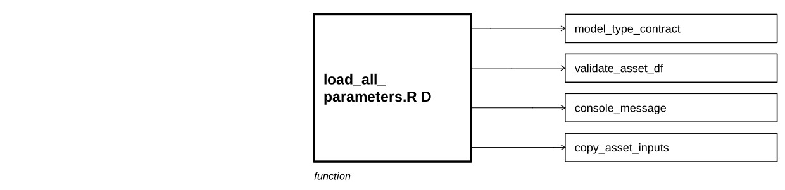

# load_all_parameters.R &mdash; D. The tables of the assets

Block D of [load_all_parameters.R](load_all_parameters.md), step 8.

## Steps

- **8.** Build and validate the table of each asset &mdash; [model_type_contract.R](model_type_contract.md), [validate_asset_df.R](validate_asset_df.md), [console_message.R](console_message.md), [copy_asset_inputs.R](copy_asset_inputs.md)

## Diagram

Also available as [load_all_parameters__D.svg](load_all_parameters__D.svg).

---

[Back to load_all_parameters.R](load_all_parameters.md) &nbsp;·&nbsp; [Back to the code structure index](../Code_Structure.md)
