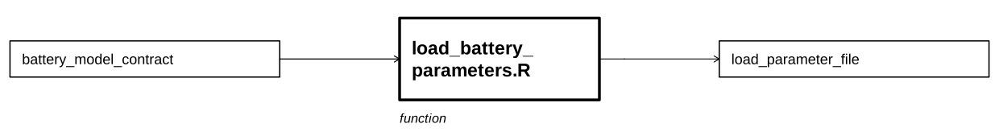

# load_battery_parameters.R

**Function** &nbsp;·&nbsp; `30_Simulation/05_Models/03_Battery/03_Functions/load_battery_parameters.R`

## Function

Loads the parameter group of one battery. It is the operation load_parameters of the contract of the type Battery (see model_type_contract()). The battery has one file in its configuration folder, 19_Battery_parameters.csv, validated against the parameter catalogue as it is read.

## Called by

- [battery_model_contract.R](battery_model_contract.md)

## What it calls, in order of appearance

- [load_parameter_file.R](load_parameter_file.md)

## Input data

- asset_paths                : List. The paths of the files of the asset, as build_asset_paths() gives them.
- validation_config          : Named list. The parameter catalogue.
- bounding_validation_config : Data frame. Content of Validation_bounding_simulation.csv. Not read.
- parameters                 : List. The parameters of the system already loaded. Not read.

## Output data

- Named list with the group of the battery:
- battery: the 9 parameters of the file:
    - Capacity
    - SOC_min
    - SOC_max
    - SOC_initial
    - Charge_power_max
    - Discharge_power_max
    - Charge_efficiency
    - Discharge_efficiency
    - Self_discharge

## Other notes from the file header

### Code outline

1. Load the file of the battery

### Usage instructions

```r
groups <- load_battery_parameters(
  asset_paths                = asset_paths,
  validation_config          = validation_config,
  bounding_validation_config = bounding_validation_config,
  parameters                 = parameters
  )
```

## Diagram



Also available as [load_battery_parameters.svg](load_battery_parameters.svg).

---

[Back to the code structure index](../Code_Structure.md)
