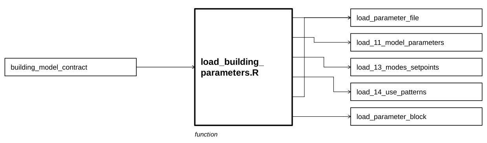

# load_building_parameters.R

**Function** &nbsp;·&nbsp; `30_Simulation/05_Models/01_Building/03_Functions/load_building_parameters.R`

## Function

Loads the parameter groups of one Building from the files of its configuration folder. It is the operation load_parameters of the contract of the type Building (see model_type_contract()). The files are read by the loading scripts of the building, each one validated against the parameter catalogue as it is read:

- 10_Operational_temperature_corrections.csv
- 11_Model_parameters.csv, from which the ventilation resistances are computed
- 13_Modes_setpoints.csv, which holds the table of the modes and, above it, the block with the deadband of the hysteresis
- 14_Use_Patterns.csv
- 18_Comfort_parameters.csv, with the comfort weight and the comfort bands of the building

The scripts are sourced into the environment of this function, where asset_paths is their paths, so that they read the files of this asset as they would read the files of the system.

## Called by

- [building_model_contract.R](building_model_contract.md)

## What it calls, in order of appearance

- [load_parameter_file.R](load_parameter_file.md) &nbsp;(2 call sites)
- [load_11_model_parameters.R](load_11_model_parameters.md)
- [load_13_modes_setpoints.R](load_13_modes_setpoints.md)
- [load_14_use_patterns.R](load_14_use_patterns.md)
- [load_parameter_block.R](load_parameter_block.md)

## Input data

- asset_paths                : List. The paths of the files of the asset, as build_asset_paths() gives them.
- validation_config          : Named list. The parameter catalogue.
- bounding_validation_config : Data frame. Content of Validation_bounding_simulation.csv.
- parameters                 : List. The parameters of the system already loaded. It must hold physical_properties.

## Output data

- Named list with the groups of the building, in this order:
- model
- operational_temperature_corrections
- setpoint_modes
- use_patterns
- comfort
- control, the block of parameters of the modes file (Deadband), under the group the catalogue gives its rows

## Other notes from the file header

### Code outline

1. Load the files of the building
2. Gather the groups

### Usage instructions

```r
groups <- load_building_parameters(
  asset_paths                = asset_paths,
  validation_config          = validation_config,
  bounding_validation_config = bounding_validation_config,
  parameters                 = parameters
  )
```

## Diagram



Also available as [load_building_parameters.svg](load_building_parameters.svg).

---

[Back to the code structure index](../Code_Structure.md)
