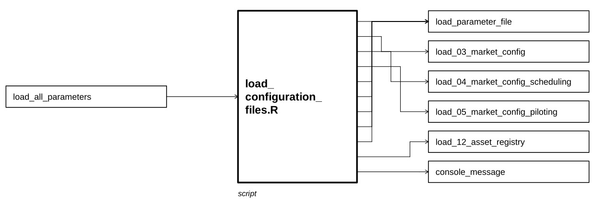

# load_configuration_files.R

**Script** &nbsp;·&nbsp; `30_Simulation/04_Scripts/load_configuration_files.R`

## Function

Loads every configuration file of the system, in the order of their numbers, and the files of each asset of the asset registry, each one validated against the parameter catalogue as it is read. A file of parameter/value lines is loaded by load_parameter_file(), which takes the names from the file and the types from the catalogue. The files that need more than that keep a script of their own:

- the market configuration, whose aim codes are translated and whose horizons are checked against the market resolution
- the two market tables

The loading dependencies hold in this order: Market is loaded after Optimization. The control of the system, parameters$control, is the flexibility event configuration. The asset registry is loaded last: each asset loads its own files, from its own configuration folder, through the contract of its type of model, and takes from the system parameters loaded before it the physical properties. The comfort weight and the comfort bands are not in the reward file: each Building loads them from its own file. The verification battery sources this script too, so the two load the same parameters in the same order. The scripts it sources run in the environment this script runs in (local = TRUE), so they fill the parameters of whoever sources it.

## Called by

- [load_all_parameters.R](load_all_parameters.md)

## What it calls, in order of appearance

- [load_parameter_file.R](load_parameter_file.md) &nbsp;(6 call sites)
- [load_03_market_config.R](load_03_market_config.md)
- [load_04_market_config_scheduling.R](load_04_market_config_scheduling.md)
- [load_05_market_config_piloting.R](load_05_market_config_piloting.md)
- [load_12_asset_registry.R](load_12_asset_registry.md)
- [console_message.R](console_message.md)

## Input data

- paths                      : List. Paths set by initialize_simulator().
- validation_config          : Named list. The parameter catalogue.
- bounding_validation_config : Data frame. Content of Validation_bounding_simulation.csv.
- parameters                 : List. The parameters being assembled, with the internal parameters already loaded.

## Output data

- parameters, with the sub-lists:
    - optimization
    - control
    - market
    - market_config_scheduling
    - market_config_piloting
    - energy_price
    - flexibility_price_emulation
    - reward
    - forecast
    - assets, one entry per asset, with its asset_id, its asset_type and the groups of its type of model. A Building holds:
        - model
        - operational_temperature_corrections
        - setpoint_modes
        - use_patterns
        - comfort, from 18_Comfort_parameters.csv
- One LOAD line is written to the console, after the lines of the assets, with the market resolution and the optimization aims.
- The scripts it sources write nothing.

## Other notes from the file header

### Code outline

1. Optimization parameters
2. Market configuration
3. Market configuration, scheduling
4. Market configuration, piloting
5. Energy price parameters
6. Flexibility price emulation
7. Flexibility event configuration
8. Reward parameters
9. Forecast parameters
10. Asset registry

11. Report

### Usage instructions

```r
source(file.path("30_Simulation", "04_Scripts",
  "load_configuration_files.R"))
```

Not called: sourced by load_all_parameters(), which supplies paths, the validation tables and parameters.

## Diagram



Also available as [load_configuration_files.svg](load_configuration_files.svg).

---

[Back to the code structure index](../Code_Structure.md)
