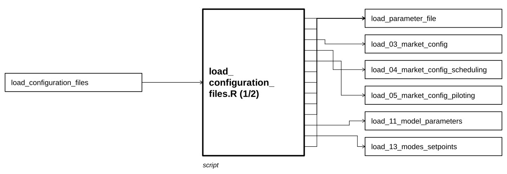

# load_configuration_files.R &mdash; Called items, block 1 of 2

Block 1 of 2 of [load_configuration_files.R](load_configuration_files.md).

## What it calls, in this block

- [load_parameter_file.R](load_parameter_file.md)
- [load_03_market_config.R](load_03_market_config.md)
- [load_04_market_config_scheduling.R](load_04_market_config_scheduling.md)
- [load_05_market_config_piloting.R](load_05_market_config_piloting.md)
- [load_11_model_parameters.R](load_11_model_parameters.md)
- [load_13_modes_setpoints.R](load_13_modes_setpoints.md)

## Diagram

Also available as [load_configuration_files__1.svg](load_configuration_files__1.svg).

---

[Back to load_configuration_files.R](load_configuration_files.md) &nbsp;·&nbsp; [Back to the code structure index](../Code_Structure.md)
