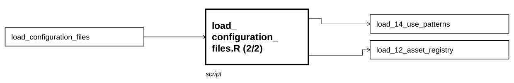

# load_configuration_files.R &mdash; Called items, block 2 of 2

Block 2 of 2 of [load_configuration_files.R](load_configuration_files.md).

## What it calls, in this block

- [load_14_use_patterns.R](load_14_use_patterns.md)
- [load_12_asset_registry.R](load_12_asset_registry.md)

## Diagram

Also available as [load_configuration_files__2.svg](load_configuration_files__2.svg).

---

[Back to load_configuration_files.R](load_configuration_files.md) &nbsp;·&nbsp; [Back to the code structure index](../Code_Structure.md)
