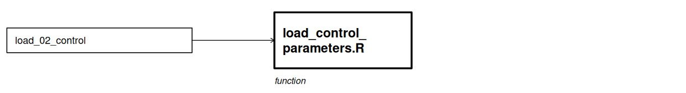

# load_control_parameters.R

**Function** &nbsp;·&nbsp; `30_Simulation/03_Functions/load_control_parameters.R`

## Function

Structures the control parameters that apply whatever control_type is chosen, as read and validated from 02_Control.csv, into the first part of parameters$control. control_type is kept as text ("modes" or "setpoints"); every other value is converted to a number.

## Called by

- [load_02_control.R](load_02_control.md)

## What it calls, in order of appearance

- Nothing: this piece calls no other piece of the project.

## Input data

- values : Named list. Raw parameter/value pairs of 02_Control.csv, as returned by read_and_validate_parameter_csv():
    - control_type : "modes" or "setpoints"
    - Deadband : width of the hysteresis band [degC]
    - set_point_default_heating : heating setpoint when no market has set one [degC]
    - set_point_default_cooling : cooling setpoint when no market has set one [degC]
    - pad_heating : heating setpoint beyond the optimized horizon [degC]
    - pad_cooling : cooling setpoint beyond the optimized horizon [degC]

## Output data

- Named list with the same six elements, control_type as text and the rest as numbers.

## Other notes from the file header

### Code outline

1. Keep control_type as text and convert the rest to numbers.

### Usage instructions

```r
control <- load_control_parameters(raw_values)
```

## Diagram



Also available as [load_control_parameters.svg](load_control_parameters.svg).

---

[Back to the code structure index](../Code_Structure.md)
