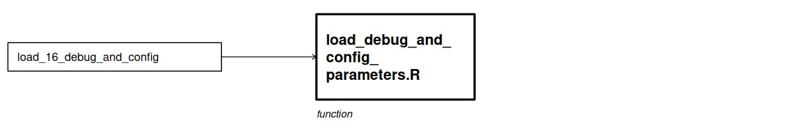

# load_debug_and_config_parameters.R

**Function** &nbsp;·&nbsp; `30_Simulation/03_Functions/load_debug_and_config_parameters.R`

## Function

This function structures the already-parsed debug and configuration parameters (as read and validated by read_and_validate_parameter_csv() from 16_Debug_and_config.csv) into a named list. All values are coerced to numeric.

## Called by

- [load_16_debug_and_config.R](load_16_debug_and_config.md)

## What it calls, in order of appearance

- Nothing: this piece calls no other piece of the project.

## Input data

- values : Named list. Raw parameter/value pairs for debug and config parameters, as returned by read_and_validate_parameter_csv(). Expected parameters are: month_subset    – month filter (0 = all months, 1-12 = specific month) period_subset   – period filter (0 = all periods, >0 = limit timesteps) verbose         – verbosity flag (0 = silent, 1 = print progress) parallel        – parallelization flag (1 = parallel, 0 = sequential) parallel_workers – worker processes when parallel = 1 (0 = all logical cores but one) Price_emulation – price emulation flag (1 = enabled, 0 = disabled) random_seed     – random number generator seed (0 = do not fix the seed)

## Output data

- A named list with the following elements: month_subset    : Month filter index (numeric). period_subset   : Period filter index (numeric). verbose         : Verbosity flag converted to logical (TRUE/FALSE). parallel        : Parallelization flag (numeric, 1 or 0). parallel_workers: Worker processes of the optimizer when parallel is 1 (numeric). 0 means all logical cores but one. Price_emulation : Price emulation flag (numeric, 1 or 0). random_seed     : Random number generator seed (numeric). 0 means the seed is not fixed and the run uses system entropy.

## Other notes from the file header

### Code outline

1. Coerce all values to numeric
2. Build named list, converting verbose to logical (== 1)

### Usage instructions

```r
params <- load_debug_and_config_parameters(raw_values)
```

## Diagram



Also available as [load_debug_and_config_parameters.svg](load_debug_and_config_parameters.svg).

---

[Back to the code structure index](../Code_Structure.md)
