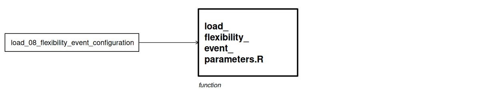

# load_flexibility_event_parameters.R

**Function** &nbsp;·&nbsp; `30_Simulation/03_Functions/load_flexibility_event_parameters.R`

## Function

Structures the parameters that define a flexibility event, as read and validated from 08_Flexibility_Event_Configuration.csv:

- the phases of the event
- the convergence of its Recovery Phase
- the system that renders an upward event
- the feasibility of a window
- the tolerances and margin of the commitment

flex_up_max_power_heating is kept as text; every other value is converted to a number.

## Called by

- [load_08_flexibility_event_configuration.R](load_08_flexibility_event_configuration.md)

## What it calls, in order of appearance

- Nothing: this piece calls no other piece of the project.

## Input data

- values : Named list. Raw parameter/value pairs of 08_Flexibility_Event_Configuration.csv:
    - commitment_phase_length_max : maximum duration of the Commitment Phase [h]
    - neutral_phase_timespan : duration of the Neutral Phase [h]
    - recovery_phase_timespan : duration of the Recovery Phase [h]
    - minimum_flexibility : smallest flexibility worth committing [kW]
    - recovery_convergence_window : window at the end of the control horizon over which the convergence of the Recovery Phase is measured [min]
    - recovery_convergence_tol_rel : relative tolerance of that check [%]
    - recovery_convergence_tol_abs : absolute tolerance of that check [kW]
    - flex_up_horizon_long : long horizon over which the system of an upward event is chosen [h]
    - flex_up_horizon_short : short horizon of the same choice [h]
    - flex_up_dominance_threshold : share a system must dominate by to render an upward event [%]
    - flex_up_max_power_heating : rated power an upward heating event may reach, Q_hp_heat_1 or Q_hp_heat_2 (text)
    - flex_feasibility_tolerance : share of the dominant increment below which the other system does not count as a decision [%]
    - flex_feasibility_floor : increment below which neither system counts as a decision [kWh]
    - flex_restatement_tol : energy a re-stated standing commitment may miss its target by [kWh]
    - flexibility_commitment_margin : electrical headroom every market slot of a window keeps against the limit of its system [kW]

## Output data

- Named list with the same fifteen elements.

## Other notes from the file header

### Code outline

1. Keep flex_up_max_power_heating as text and convert the rest to numbers.

### Usage instructions

```r
flexibility_events <- load_flexibility_event_parameters(raw_values)
```

## Diagram



Also available as [load_flexibility_event_parameters.svg](load_flexibility_event_parameters.svg).

---

[Back to the code structure index](../Code_Structure.md)
