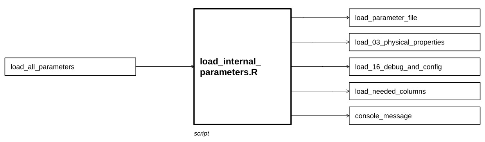

# load_internal_parameters.R

**Script** &nbsp;·&nbsp; `30_Simulation/04_Scripts/load_internal_parameters.R`

## Function

Loads the internal parameters: what the assembly of Main_df and the loaders of the configuration files need before any of those files is read.

- the computing parameters, which set the master time grid of Main_df
- the physical properties
- the debug and configuration switches
- the list of needed columns

Every file is validated against the parameter catalogue as it is read. The verification battery sources this script too, so the two load the same parameters in the same order. The scripts it sources run in the environment this script runs in (local = TRUE), so they fill the parameters of whoever sources it.

## Called by

- [load_all_parameters.R](load_all_parameters.md)

## What it calls, in order of appearance

- [load_parameter_file.R](load_parameter_file.md)
- [load_03_physical_properties.R](load_03_physical_properties.md)
- [load_16_debug_and_config.R](load_16_debug_and_config.md)
- [load_needed_columns.R](load_needed_columns.md)
- [console_message.R](console_message.md)

## Input data

- paths             : List. Paths built by initialize_simulator().
- validation_config : Named list. The parameter catalogue, read by load_parameter_catalogue().
- parameters        : List. The parameters being assembled, empty when this script starts.

## Output data

- parameters, with the sub-lists:
    - computing
    - physical_properties
    - debug_and_config
    - needed_cols          : every column of Main_df, in the order of the output table Main_df_computed
    - needed_cols_assembly : the columns the assembled Main_df must hold
    - asset_cols           : a list with one element per type of model, with every column of the table of an asset of the type, time first, in the order of the output table of each asset
    - asset_cols_assembly  : a list with one element per type of model, with the columns the assembled table of an asset of the type must hold
    - asset_input_cols     : a list with one element per type of model, with the inputs of the type: the columns of Main_df that the table of each asset of the type holds a copy of during the whole run
    - joined_cols          : every column of Main_df and of the tables of every type, once, in the order of the pieces the markets and the execution work on
    - itinerary_variables  : a list with one element per type of model, with the variables of the type expanded into the four itineraries (see itinerary_columns())
- One LOAD line is written to the console, once the parameters are loaded. The scripts it sources write nothing.

## Other notes from the file header

### Code outline

1. Computing parameters
2. Physical properties
3. Debug and configuration
4. Needed columns
5. Report

### Usage instructions

```r
source(file.path("30_Simulation", "04_Scripts",
  "load_internal_parameters.R"))
```

Not called: sourced by load_all_parameters(), which supplies paths, validation_config and parameters.

## Diagram



Also available as [load_internal_parameters.svg](load_internal_parameters.svg).

---

[Back to the code structure index](../Code_Structure.md)
